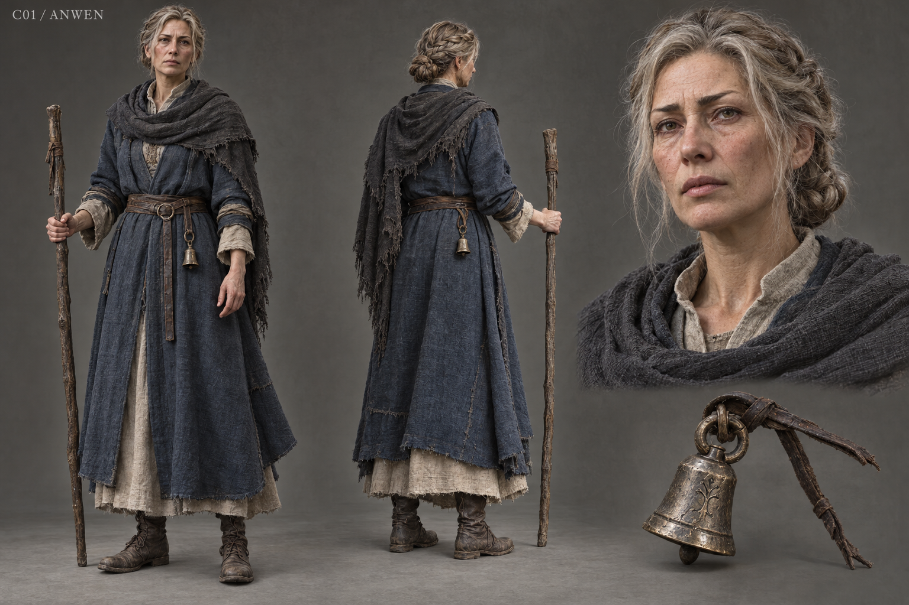

# C01 - Sister Anwen

Established character / new visual design

**Status:** illustrated 2D design and 3D production reference. Visual design is proposed; runtime model production is not included.

## Slug

sister_anwen

## Canonical status

Existing principal living NPC

## Region

Greyfen shrine and cemetery

## Role

Shrine keeper; the human gateway into the failed containment and the village's conscience

## Canon facts

- Forty-six years old; not personally responsible for the original massacre thirty-two years ago.
- Tied burial thread around recovered names; failed containment and later concealment are her present responsibility.
- A novice died last winter; she cut the bell rope and resealed the chapel.
- Offers a traveler a cup, keeps Oren's coat, and can offer or refuse her own testimony.
- Established presentation: pale hair, slate blue, staff and dull bell token; target height 1.68 m.

## Desire

Keep the shrine useful to frightened living people without allowing protection to become another demand for silence.

## Contradiction

She knows care is freely offered yet has repeatedly managed other people's knowledge for their supposed safety.

## Secret

**Status**

Canonical disclosed history

**Text**

The failed burial-thread containment and the novice's death; neither makes her author of the original crime.

## Visual description

A forty-six-year-old woman with weather-paled olive skin, a long alert face, uneven brows and clear tired eyes. Fine lines remain around the eyes and mouth. Pale blonde-grey hair is braided and pinned low, exposing the entire face. A repaired slate-blue wool outer gown sits over warm unbleached linen, with a dark ash-grey shoulder shawl, secured sleeves and practical ankle boots. The narrow leather belt carries a small dull bell token and a folded cloth. Her plain ash staff is held beside the body, its grip polished by years of use. Her posture offers attention without a saintly pose or youthful glamour.

## Palette

- **name:** slate blue; **hex:** #4C6272
- **name:** warm linen; **hex:** #D6CCAF
- **name:** ash wool; **hex:** #565653
- **name:** dull pewter; **hex:** #81817A

## Scale

**Height m**

1.68

**Basis**

Existing target height

## Signature prop

Dull bell token; plain ash staff with an established hand attachment

## Relationships

- **with:** Mira Fen; **basis:** Canonical shared care for the village; proposed closer treatment partnership
- **with:** Oren Vey; **basis:** Canonical keeps his coat and recognizes the failed rite; never resurrect him through this design
- **with:** Record Keeper Vale; **basis:** Proposed partnership that separates voluntary memory rites from documentary proof

## Act arc

**Established**

Offers help, admits the failed rite, confronts the chapel's containment, then decides whether to speak freely.

**Proposed forward**

Builds a consent-led sanctuary with treatment and shelter available regardless of ritual participation; the aftermath tests whether an institution can surrender control while remaining useful.

## Branch outcomes proposed

- Open sanctuary: she shares procedures and trains carers while keeping private testimony protected.
- Protected sanctuary: she keeps intimate rites private but makes institutional records accessible.
- Overburdened sanctuary: low support leaves her exhausted and limits opening hours without making aid conditional on agreement.

## Animation brief

**Locomotion**

Measured heel-to-toe walk; planted feet; staff contact authored against the floor.

**Performance**

Attentive stillness, restrained nod, a small self-correction before an admission, cup offered from an actual hand socket.

**Clips**

- idle_attentive
- walk_staff
- offer_cup
- place_cloth
- dialogue_concern
- admit
- sit_rest

**Constraints**

Face unobstructed; staff on hand bone; no floating token near the head; gestures return to rest.

## Voice line proposed

You may keep your name to yourself. The blanket is still yours.

## Sources

- S1
- S2
- S3
- S6
- S7
