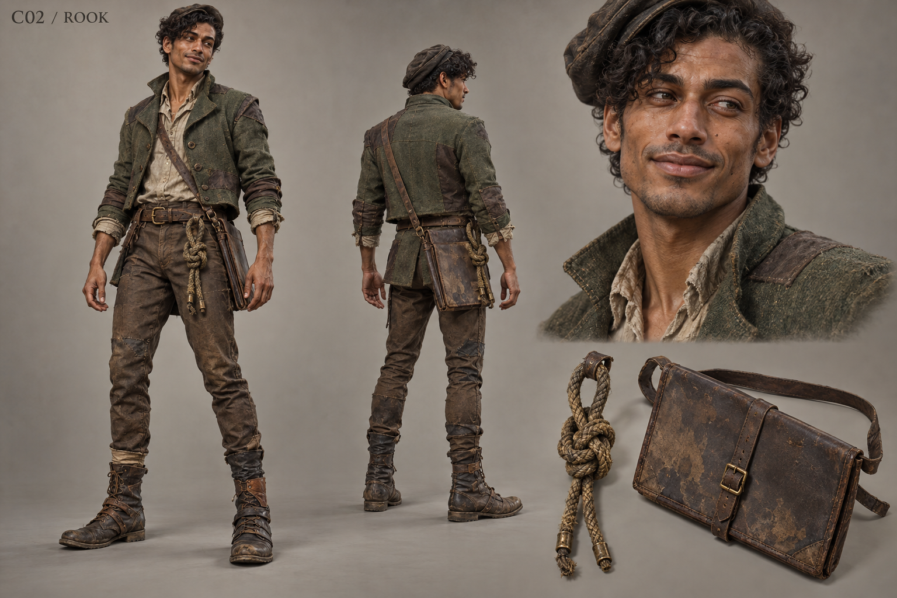

# C02 - Rook

Established character / new visual design

**Status:** illustrated 2D design and 3D production reference. Visual design is proposed; runtime model production is not included.

## Slug

rook

## Canonical status

Existing principal living NPC

## Region

Greyfen market and road routes

## Role

Traveler, trader and carrier of inherited family testimony

## Canon facts

- Twenty-nine years old; he carries inherited testimony, not firsthand knowledge of the war.
- Remembers Bram's generosity, helps the opening cart, and jokes without becoming comic relief.
- Protects household addresses in the map; public family marks can expose people without consent.
- Established presentation: narrow reed-green silhouette and doubled road knot.
- An ordinary kettle dispute connects him to Nessa.

## Desire

Keep roads usable and family testimony in the hands of those who must live with its exposure.

## Contradiction

His useful discretion can become an excuse to leave other travelers without the route they need.

## Secret

**Status**

Canonical protected information

**Text**

Inherited family marks and safe route details; these are not evidence that he witnessed the massacre.

## Visual description

A slender twenty-nine-year-old man with medium brown skin, a quick crooked smile, prominent cheekbones and closely curled black hair flattened on one side by a travel cap. His reed-green wool coat is cut short enough for cart work, repaired with darker panels, and worn over a faded linen shirt and narrow brown trousers. A doubled road knot hangs from his belt beside a flat map case, never like a magical talisman. Boots have mismatched old repairs. Long expressive fingers and a shifting, observant stance distinguish him from the stiller cast. He looks capable of carrying goods and getting caught laughing at an inconvenient moment.

## Palette

- **name:** reed green; **hex:** #65705A
- **name:** river brown; **hex:** #615142
- **name:** faded linen; **hex:** #BEB49B
- **name:** tarnished brass; **hex:** #8D7B4F

## Scale

**Height m**

1.75

**Basis**

Proposed

## Signature prop

Doubled road knot and flat, rain-stained map case

## Relationships

- **with:** Bram Kett; **basis:** Canonical remembered generosity
- **with:** Nessa; **basis:** Canonical kettle loan/wager and shared village life
- **with:** Nera; **basis:** Proposed exchange of usable route information with privacy protections

## Act arc

**Established**

Helps the player belong, shares protected records, and decides whether his own testimony is freely available.

**Proposed forward**

Becomes a negotiator between refugee routes and newly reopened trade; must decide which knowledge can be shared without turning safe paths into hunting maps.

## Branch outcomes proposed

- Protected route network: published hazards and delivery schedules omit household locations.
- Damaged trust: exposed family marks leave Rook willing to trade but unwilling to testify or share private routes.
- Lost map recovery: he rebuilds routes with travelers' permission and charges for work rather than selling their identities.

## Animation brief

**Locomotion**

Light economical walk, quick checked sidestep, believable cart-bracing contact.

**Performance**

Hands start a joke then settle when someone becomes vulnerable; reads the listener before continuing.

**Clips**

- idle_observe
- walk_trade
- brace_cart
- unfold_map
- kettle_dispute
- dialogue_wry
- fold_map

**Constraints**

Map remains hand-held; no endless gesturing or permanent sly grin.

## Voice line proposed

I can tell you where the road goes. Where people hide is a different bargain.

## Sources

- S1
- S2
- S3
- S4
- S5
