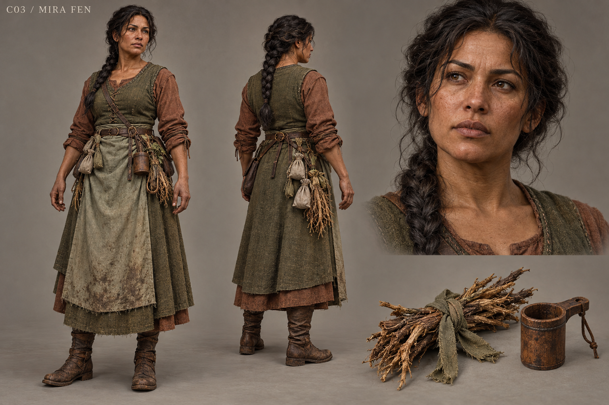

# C03 - Mira Fen

Established character / new visual design

**Status:** illustrated 2D design and 3D production reference. Visual design is proposed; runtime model production is not included.

## Slug

mira_fen

## Canonical status

Existing principal living NPC

## Region

Greyfen herb garden and Wychwood

## Role

Herbalist whose useful remedies expose the cost of inherited wrongdoing

## Canon facts

- Treats Toma's daughter's fever and remembers Oren's practical needs.
- Ash-fed roots made useful medicine while denying families informed choice.
- Slower clean-root treatment must remain available to families who refuse ash treatment.
- Established presentation: olive work clothes, practical layers, tied root ribbon.

## Desire

Make care effective and honestly chosen even when the honest alternative takes longer.

## Contradiction

She distinguishes useful from consented in principle yet concealed where her most effective treatment came from.

## Secret

**Status**

Canonical disclosure

**Text**

The medicinal ash bed connects present care to the refugees' burned remains; inspecting the bed must never automatically choose a patient's treatment.

## Visual description

A proposed thirty-seven-year-old woman of compact, strong build with warm umber skin, broad cheeks, a softly squared nose and black hair gathered in a thick practical braid. Her olive wool sleeveless overdress is layered over a russet long-sleeved linen shift, with a faded sage work apron and firmly tied cuffs. Dirt collects naturally beneath the nails and at the apron hem rather than across the face. Pouches hold labelled cloth packets, a small wooden measure and bundled roots tied with plain ribbon. Her shoulders incline toward the task, not toward submissiveness. Clear, questioning eyes and a grounded stance convey professional care and discomfort with easy answers.

## Palette

- **name:** olive wool; **hex:** #66704D
- **name:** russet linen; **hex:** #8B6550
- **name:** sage apron; **hex:** #9A9D7C
- **name:** root bark; **hex:** #604934

## Scale

**Height m**

1.61

**Basis**

Proposed

## Signature prop

Tied root ribbon and wooden medicine measure

## Relationships

- **with:** Farmer Toma; **basis:** Canonical treatment of his daughter
- **with:** Sister Anwen; **basis:** Canonical overlapping care and memory knowledge; proposed shared clinic
- **with:** Nessa; **basis:** Proposed clean-food and convalescent-meal planning

## Act arc

**Established**

Explains bounded naming, faces the garden's origin, and offers disclosure or slower replacement care without forcing assent.

**Proposed forward**

Creates a replacement medicine garden and an apprentice practice; each crop shortage tests whether honest care survives scarcity.

## Branch outcomes proposed

- Clean-root practice: slower recovery creates supply and staffing quests.
- Disclosed interim practice: willing families choose temporary ash treatment while clean stock grows.
- Broken confidence: patients choose another carer; Mira continues providing supplies and records without forcing reconciliation.

## Animation brief

**Locomotion**

Stable short stride suitable for carrying jars.

**Performance**

Counts portions, checks a label, asks before reaching toward another person's hand, breathes out after disclosure.

**Clips**

- idle_sort_roots
- walk_basket
- measure_dose
- write_label
- dialogue_explain
- offer_treatment
- tend_bed

**Constraints**

No glowing hands or witch glamour; hand contact requires consent and actual pose alignment.

## Voice line proposed

It works. That is the part I told them. It was not the whole answer.

## Sources

- S1
- S2
- S3
