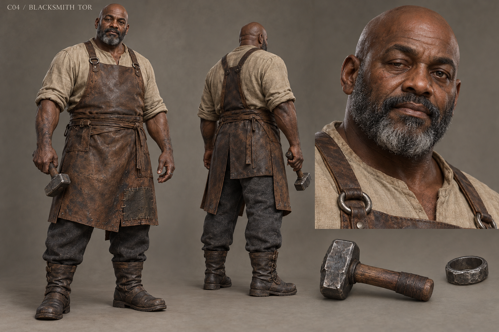

# C04 - Blacksmith Tor

Established character / new visual design

**Status:** illustrated 2D design and 3D production reference. Visual design is proposed; runtime model production is not included.

## Slug

blacksmith_tor

## Canonical status

Existing principal living NPC

## Region

Greyfen forge and road works

## Role

The maker who must replace useful stolen iron without leaving the village helpless

## Canon facts

- Keeps hinges, tools, carts and roads working; gives useful scrap.
- Ground off refugee ownership marks for convenience.
- Can disclose working stock, replace it gradually with memorial work, or surrender disputed iron while ordinary scrap remains available.
- Established presentation: broad charcoal-and-leather silhouette and plain iron ring.

## Desire

Leave behind work that can be used without requiring somebody else's story to be erased.

## Contradiction

His practical pride made provenance seem like someone else's problem.

## Secret

**Status**

Canonical admission

**Text**

The removed refugee marks on useful iron; disclosure does not make all future tool preparation unavailable.

## Visual description

A proposed fifty-one-year-old man with deep brown skin, a broad barrel chest, thick forearms and a close silver-black beard around a bald scalp. His face is open and square with one slightly drooping eyelid, a healed cheek nick and patient eyes. Charcoal wool trousers and an unbleached collarless shirt sit beneath a heavy split leather apron, patched at the thigh where hot scale lands. A plain iron ring and a short working hammer are his only adornments. Boots are wide and reinforced, not armored greaves. Charcoal dust follows the hands and apron rather than obscuring the anatomy. His stance is heavy, useful and unshowy.

## Palette

- **name:** charcoal wool; **hex:** #3F4140
- **name:** worked leather; **hex:** #6A4938
- **name:** iron; **hex:** #747775
- **name:** warm shirt; **hex:** #B8AA8D

## Scale

**Height m**

1.82

**Basis**

Proposed

## Signature prop

Plain iron ring and short working hammer

## Relationships

- **with:** Widow Elna; **basis:** Canonical practical door repair in regional work
- **with:** Farmer Toma; **basis:** Canonical useful weights and tools
- **with:** Steward Merrow; **basis:** Proposed contested stock ledger and restitution workload

## Act arc

**Established**

Provides ordinary help, admits the removed marks, then makes restitution tangible in tools and memorial fittings.

**Proposed forward**

Organizes apprentices and clean scrap supply; must resist a profitable commission that would consume the metal promised for safe roads.

## Branch outcomes proposed

- Gradual replacement: functioning tools remain in service while new marked stock replaces them.
- Immediate surrender: shortages create shared repair labor and rationed workshop time.
- Memorial commission: names remain beside useful public fittings rather than buried inside weapons.

## Animation brief

**Locomotion**

Weighted walk with believable load transfer, no permanent bodybuilder flex.

**Performance**

Checks heat before gripping metal; puts the hammer down before difficult speech.

**Clips**

- idle_inspect
- forge_hammer
- carry_stock
- drive_peg
- set_tool_down
- dialogue_admit
- repair_hinge

**Constraints**

Hammer strikes match anvil contact; hands stay clear of glowing metal without tools.

## Voice line proposed

A hinge can be sound and still be stolen. I know how to mend only one of those with a hammer.

## Sources

- S1
- S2
- S3
- S4
- S5
