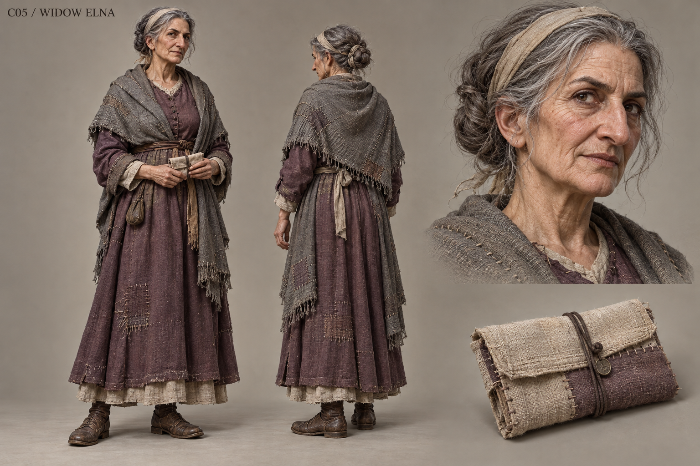

# C05 - Widow Elna

Established character / new visual design

**Status:** illustrated 2D design and 3D production reference. Visual design is proposed; runtime model production is not included.

## Slug

widow_elna

## Canonical status

Existing principal living NPC

## Region

Greyfen home and cemetery

## Role

The keeper of ordinary love who refuses to let grief excuse the closed gate

## Canon facts

- Loved Harl and remembers him warming shoes, including an embarrassing burned one.
- Harl kept his gate role private for years and died last winter.
- A kinder family war account concealed those left outside the gate.
- Her grief and public participation remain her choice; Harl's act remains documented.
- Established presentation: muted plum and ash grey, folded name packet, held downward gaze.

## Desire

Tell her family a whole account without allowing strangers to own her grief.

## Contradiction

The tenderness she remembers is true, and so is the harm her kinder story concealed.

## Secret

**Status**

Canonical family concealment

**Text**

The version of Harl's wartime life she helped preserve omitted the barred gate; affection does not settle accountability.

## Visual description

A proposed seventy-one-year-old woman, short and narrow through the shoulders, with pale weathered skin, a prominent aquiline nose, sharp dark eyes and deeply settled smile lines. Iron-grey hair is twisted into a low coil, with loose strands kept out of her face by a plain linen band. A muted plum wool dress and ash-grey shawl are repeatedly repaired with fine, patient stitching. Her hands show age and skill, holding a neatly folded name packet in a small cloth sleeve. Sensible worn shoes remain visible beneath the hem. She is neither a frail prop nor a gothic widow: a straight-backed neighbor who still notices everything.

## Palette

- **name:** muted plum; **hex:** #705967
- **name:** ash grey; **hex:** #8A8780
- **name:** undyed linen; **hex:** #CEC3A7
- **name:** old ink; **hex:** #484547

## Scale

**Height m**

1.55

**Basis**

Proposed

## Signature prop

Folded name packet in a repaired cloth sleeve

## Relationships

- **with:** Harl; **basis:** Canonical late husband; do not depict him as living
- **with:** Blacksmith Tor; **basis:** Canonical practical repair connection
- **with:** Record Keeper Vale; **basis:** Proposed limits on copying family records without erasing public wrongdoing

## Act arc

**Established**

Receives the account, holds love and wrongdoing together, and chooses public speech or privacy.

**Proposed forward**

Becomes a demanding editor of the village's memorial: accurate about responsibility and exact about whose personal memories may be printed.

## Branch outcomes proposed

- Public account: she speaks once and defines what can be quoted afterward.
- Private account: the gate action is recorded while her letters remain closed.
- Withdrawn participation: she stops attending meetings but still helps repair neighbors' clothes; refusal does not remove her from ordinary life.

## Animation brief

**Locomotion**

Deliberate compact steps and steady balance; no exaggerated frailty.

**Performance**

Long stillness, packet folded carefully, gaze lifted directly when challenged.

**Clips**

- idle_packet
- walk_slow
- mend_cloth
- read_letter
- dialogue_remember
- set_boundary
- sit_window

**Constraints**

Age in face and hands without trembling caricature; packet never penetrates palms.

## Voice line proposed

He was kind to me. Put that beside what he did, not over it.

## Sources

- S1
- S2
- S3
- S4
