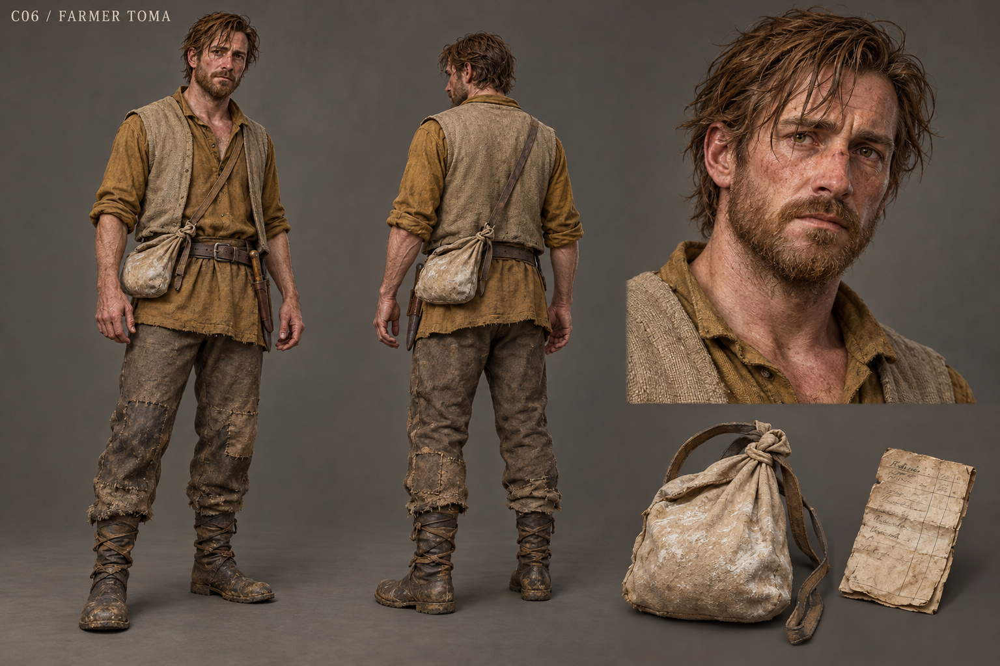

# C06 - Farmer Toma

Established character / new visual design

**Status:** illustrated 2D design and 3D production reference. Visual design is proposed; runtime model production is not included.

## Slug

farmer_toma

## Canonical status

Existing principal living NPC

## Region

Greyfen fold, fields and village supply route

## Role

A father whose secret protection creates a danger his neighbors must also bear

## Canon facts

- A father with a feverish daughter; Mira provides care.
- Tends the fold and brings grain into village life.
- Hid a dangerous Black Dog protection fragment that once saved his child.
- Relocation, disclosed supervision or ending the fragment are explicit existing options.
- Established presentation: ochre and grain cloth; flour-coloured packet.

## Desire

Let his daughter sleep safely without making another family pay for that safety.

## Contradiction

He asks for neighbors' solidarity while withholding the danger they share.

## Secret

**Status**

Canonical concealed protector

**Text**

The Black Dog fragment; this is a bounded protection memory, not a benevolent pet or a complete returned person.

## Visual description

A proposed thirty-nine-year-old man with a rangy frame, sun-reddened freckled skin, tired hazel eyes and a short uneven reddish-brown beard. His nose has been broken once and healed slightly off-center. A faded ochre tunic, grain-coloured sleeveless overvest and patched wool trousers show labor through wear at knees and cuffs. One simple canvas packet bears flour dust; a small utility knife is sheathed for farm work. Coarse hair falls forward despite being combed with water. His hands are broad and callused, his posture a little sleepless rather than weak. The silhouette is long and practical, clearly different from Tor's heavy forge build.

## Palette

- **name:** ochre cloth; **hex:** #A5874C
- **name:** grain canvas; **hex:** #C3B48B
- **name:** field brown; **hex:** #756146
- **name:** damp moss; **hex:** #666B4E

## Scale

**Height m**

1.79

**Basis**

Proposed

## Signature prop

Flour-coloured packet and simple folded grain receipt

## Relationships

- **with:** Mira Fen; **basis:** Canonical care of his daughter
- **with:** Nessa; **basis:** Canonical grain delivery and scale correction
- **with:** Nera; **basis:** Proposed safe route for the supervised protection boundary

## Act arc

**Established**

Reveals the dangerous guardian, accepts a practical boundary and keeps caring for his child.

**Proposed forward**

Becomes the voice of households asked to support restitution while feeding children; proposes a seed reserve instead of another protective bargain.

## Branch outcomes proposed

- Relocated guardian: marked routes keep children and travelers away from the fragment's boundary.
- Disclosed supervision: neighbors share an agreed watch and can withdraw without losing grain.
- Settled fragment: ordinary fencing and watch labor replace supernatural protection, with visible shortages and new cooperation.

## Animation brief

**Locomotion**

Long work stride shortened when carrying a sack.

**Performance**

Checks the doorway while speaking; hands stop fidgeting only after a practical plan is made.

**Clips**

- idle_tired
- carry_grain
- check_fold
- read_receipt
- dialogue_defend
- dialogue_accept
- sit_watch

**Constraints**

Tiredness without slapstick; packet and sack have consistent weight.

## Voice line proposed

I wanted one quiet night for her. I stopped counting whose night it might cost.

## Sources

- S1
- S2
- S3
- S4
- S5
- S8
