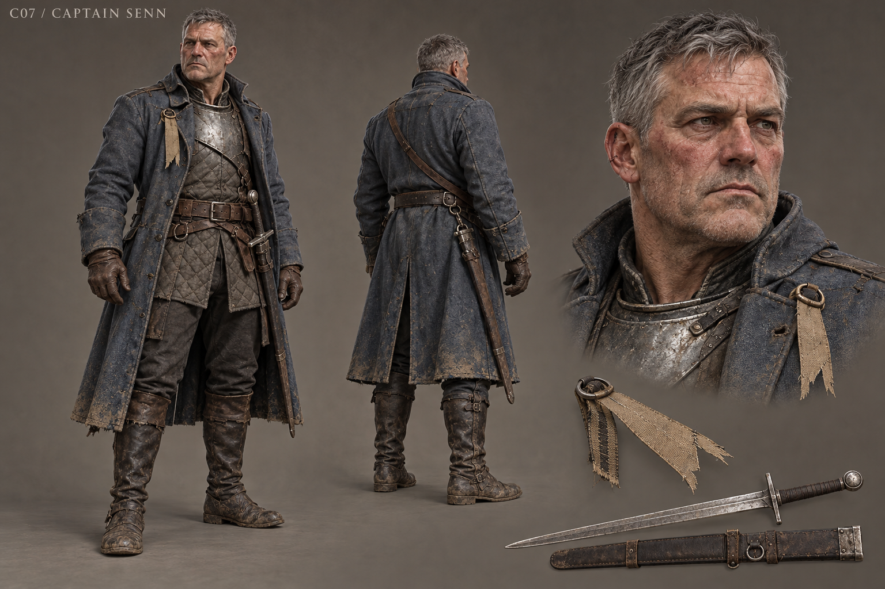

# C07 - Captain Senn

Established character / new visual design

**Status:** illustrated 2D design and 3D production reference. Visual design is proposed; runtime model production is not included.

## Slug

captain_senn

## Canonical status

Existing principal living NPC; may be absent after the player's resolution

## Region

Bandit Road command clearing

## Role

An accountable military participant whose present raids repeat the language of protection

## Canon facts

- Fifty-four; twenty-two-year-old officer during the massacre thirty-two years earlier.
- Closed the military retreat after Halvern refused.
- Now controls the bandit road and uses old injury to excuse current raids.
- Custody with voluntary testimony, disarmed exile, or execution remain real existing choices.
- Established presentation: worn blue-grey uniform and cut military oath ribbon.

## Desire

Make his suffering count as something more than obedience while retaining authority over the road.

## Contradiction

He demands recognition of past wrongs while committing present coercion.

## Secret

**Status**

Canonical admission

**Text**

His role in closing the retreat; testimony establishes responsibility and does not purchase absolution.

## Visual description

A fifty-four-year-old man with a thick neck, a once-powerful frame gone slightly heavy, fair windburned skin and iron-grey hair cropped close. His jaw is broad, the mouth tight, and one ear is nicked rather than theatrically torn. A worn blue-grey military coat hangs over a repaired quilted jack, with a limited steel breastplate, sensible leather belt and knee-high mud-marked boots. The cut oath ribbon is visible at the breast; the old insignia has been unpicked. His sword is serviceable, not legendary. He stands with an officer's habitual economy, carrying pain in a guarded shoulder rather than in oversized armor or a permanent villain sneer.

## Palette

- **name:** worn blue-grey; **hex:** #66727A
- **name:** old iron; **hex:** #6C706D
- **name:** weathered leather; **hex:** #5D493A
- **name:** cut ribbon; **hex:** #A9997C

## Scale

**Height m**

1.83

**Basis**

Proposed

## Signature prop

Cut military oath ribbon; service sword and plain scabbard

## Relationships

- **with:** Sir Halvern; **basis:** Canonical officer who obeyed after Halvern refused; Halvern knows no later events
- **with:** Nera; **basis:** Canonical crossing labor continues after every Senn outcome
- **with:** Steward Merrow; **basis:** Proposed investigation of current logistics; no new mastermind attribution

## Act arc

**Established**

Loses or voluntarily lowers his guard, admits the command, and faces custody, exile or execution.

**Proposed forward**

If alive and present, he must do supervised repair labor and answer specific claims without converting service into pardon. Exile or death routes use his existing written record and other living workers.

## Branch outcomes proposed

- Custody continuation: practical work is supervised and victims choose whether to attend hearings.
- Exile continuation: his testimony survives; road management passes to local accountable crews.
- Execution continuation: no new Senn dialogue; unresolved duties pass to records and surviving people rather than a convenient ghost.

## Animation brief

**Locomotion**

Disciplined planted gait with slight guarded shoulder.

**Performance**

Hand leaves the sword when admitting responsibility; surrender is a clear authored state.

**Clips**

- idle_guard
- walk_military
- draw_sword
- parry
- guard_break
- surrender
- dialogue_admit
- carry_plank

**Constraints**

Combat clips use existing authoritative damage timing; custody, exile and death states must gate later appearances.

## Voice line proposed

It was an order. I have said that so often it began to sound like an answer.

## Sources

- S1
- S2
- S3
- S4
- S5
- S9
