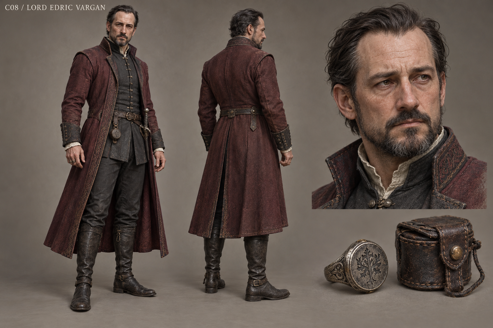

# C08 - Lord Edric Vargan

Established character / new visual design

**Status:** illustrated 2D design and 3D production reference. Visual design is proposed; runtime model production is not included.

## Slug

lord_edric_vargan

## Canonical status

Existing principal living NPC

## Region

Castle Vargan and Greyfen assembly

## Role

Competent ruler whose emergency relief makes coercion appear reasonable

## Canon facts

- Forty-three; found and suppressed the command ledger six years ago.
- Releases real grain and maintains real protection; his competence is not a trick.
- Makes grain allotments conditional on household assent to renewed concealment.
- Can cooperate voluntarily, be exposed, or be compelled to admit facts; compulsion never supplies magical consent.
- Established presentation: symmetrical cool charcoal and oxblood, tarnished seal.

## Desire

Preserve a functioning region and the authority he believes is necessary to keep it functioning.

## Contradiction

He calls it stewardship when he determines what others may know and what promises hunger must buy.

## Secret

**Status**

Canonical suppression

**Text**

Six years of concealed ledger knowledge; he did not secretly order every supernatural attack.

## Visual description

A forty-three-year-old man with light olive skin, carefully groomed dark hair receding at the temples, a neat short beard and observant grey-brown eyes. He is of average athletic build, neither kingly giant nor decadent caricature. A symmetrical charcoal wool doublet and long oxblood overcoat use expensive but subdued cloth, precise seams and restrained fastenings. A tarnished signet and seal case carry institutional weight without a crown. Clean practical boots and a discreet dagger fit a working lord who travels between storehouses and court. The face is courteous, controlled and increasingly tired, with an exact mouth that loses its rehearsed composure when the ration condition is named.

## Palette

- **name:** cool charcoal; **hex:** #3F454B
- **name:** oxblood; **hex:** #633D42
- **name:** aged silver; **hex:** #8A8982
- **name:** pale collar; **hex:** #C7BEAC

## Scale

**Height m**

1.77

**Basis**

Proposed

## Signature prop

Tarnished seal with a worn leather seal case

## Relationships

- **with:** Steward Merrow; **basis:** Canonical administration of grain and household signatures
- **with:** Record Keeper Vale; **basis:** Canonical access to command records and their suppression
- **with:** Sister Anwen; **basis:** Canonical shared renewal crisis; no private conspiracy invented

## Act arc

**Established**

Faces copied command proof, the cost of concealment and the coercive ration condition; authority or cooperation is tested in public.

**Proposed forward**

If cooperative, negotiates restitution without immunity. If exposed, remains a capable but contested supplier. If compelled, his facts survive while every future promise requires a new voluntary decision.

## Branch outcomes proposed

- Cooperation: surrenders privileges and accepts independent distribution records.
- Exposure: a council audits supplies; he can contribute expertise without unilateral terms.
- Compulsion: the account is retained, but no scene treats fear-driven words as a binding oath.

## Animation brief

**Locomotion**

Measured confident walk; turns fully toward speakers.

**Performance**

Economical open hand, one glance toward the seal, then unadorned speech when authority fails.

**Clips**

- idle_authority
- walk_court
- inspect_grain
- present_seal
- withdraw_seal
- dialogue_control
- dialogue_plain

**Constraints**

No omniscient villain smile; genuine relief work remains visible across branches.

## Voice line proposed

The sacks are real. So are the terms. I see now why that does not defend me.

## Sources

- S1
- S2
- S3
- S6
