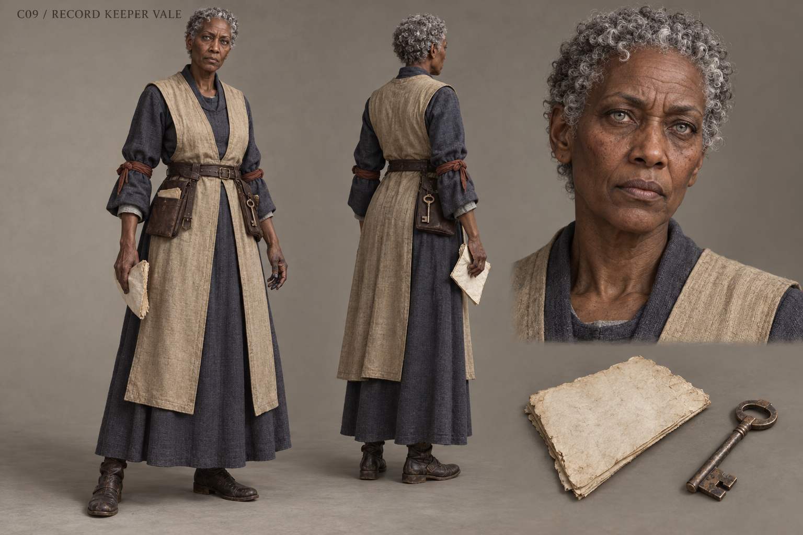

# C09 - Record Keeper Vale

Established character / new visual design

**Status:** illustrated 2D design and 3D production reference. Visual design is proposed; runtime model production is not included.

## Slug

record_keeper_vale

## Canonical status

Existing named Vargan NPC; expanded principal arc proposed

## Region

Vargan Record Hall

## Role

The custodian who kept both orders and must now make preservation mean access

## Canon facts

- Keeps Vargan's records.
- Lays an uncut page beneath a lamp and permits the hunter to read it.
- Kept sanctuary and closure orders in the same drawer while telling visitors nothing could be found.
- Asks to have her own name placed beside that concealment.
- Existing voice direction is careful, precise and finally willing to speak; female voice casting supports the proposed woman presentation but ethnicity and appearance are unspecified.

## Desire

Make the archive trustworthy after realizing intact records are useless when access is withheld.

## Contradiction

She took pride in never destroying a page while helping the institution make those pages disappear from public life.

## Secret

**Status**

Canonical admission

**Text**

Weekly care of records she denied existed; she is a custodian, not a newly invented hidden author of the massacre.

## Visual description

A proposed sixty-two-year-old woman with dark brown skin, a long broad-nosed face, deep forehead creases and tightly coiled silver hair cropped close around the head. Her pale attentive eyes sit behind no face-obscuring ornament. A smoke-indigo wool gown is belted beneath a faded parchment-coloured sleeveless tabard, with a narrow rust-red sleeve tie used to keep cuffs clear of ink. Her build is tall and spare, shoulders slightly forward from reading. Ink stains touch two fingertips; a flat archival key and folded page sit in separate leather pockets. Her clothing is carefully maintained rather than luxurious. She faces the viewer with exact, uncomfortable honesty.

## Palette

- **name:** smoke indigo; **hex:** #4C535F
- **name:** parchment cloth; **hex:** #BFB596
- **name:** rust sleeve tie; **hex:** #825947
- **name:** ink black; **hex:** #343A3C

## Scale

**Height m**

1.73

**Basis**

Proposed

## Signature prop

Uncut archival page and flat drawer key

## Relationships

- **with:** Lord Edric Vargan; **basis:** Canonical shared archive and suppressed command proof
- **with:** Widow Elna; **basis:** Proposed negotiation of public facts and private letters
- **with:** Rook; **basis:** Proposed copying protocol that removes household locations

## Act arc

**Established**

Makes the intact orders available and admits her own concealment.

**Proposed forward**

Leads a mobile duplicate archive as institutions contest the record. Her major conflict becomes who can challenge, copy and correct public history without exposing vulnerable households.

## Branch outcomes proposed

- Open reading room: accusations and corrections are logged with sources and reachable copies.
- Distributed copies: several communities hold verified records so one locked drawer cannot erase access again.
- Failed reform: renewed restrictions move the struggle into a lawful public hearing; the guaranteed main-path proof is never deleted.

## Animation brief

**Locomotion**

Tall careful stride; books carried close to the center of gravity.

**Performance**

Aligns pages before speaking, then deliberately leaves a page within another person's reach.

**Clips**

- idle_read
- walk_records
- unlock_drawer
- lay_page
- copy_document
- dialogue_admit
- hand_copy

**Constraints**

Document text need not be generated into texture; readable quest text stays in UI. No magical knowledge beyond records read.

## Voice line proposed

I kept every page. That is not the same as letting anyone read them.

## Sources

- S3
- S6
- S8
