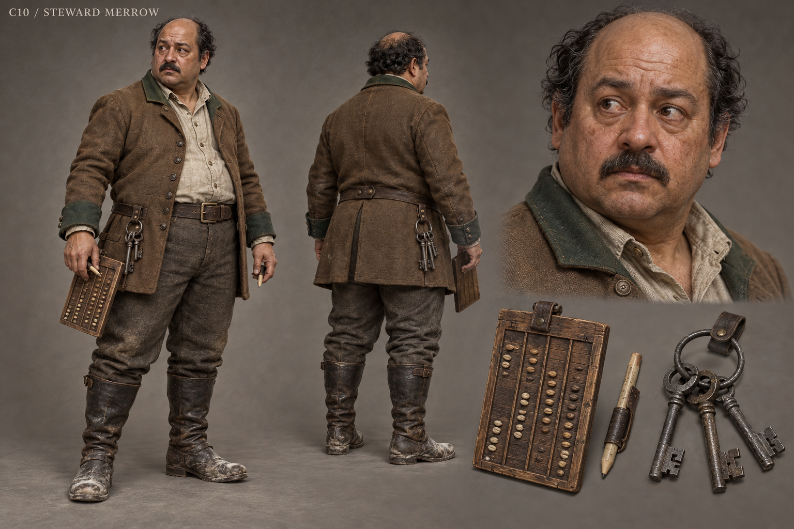

# C10 - Steward Merrow

Established character / new visual design

**Status:** illustrated 2D design and 3D production reference. Visual design is proposed; runtime model production is not included.

## Slug

steward_merrow

## Canonical status

Existing named Vargan NPC; expanded principal arc proposed

## Region

Vargan court and grain stores

## Role

The administrator whose routine turns an unjust policy into empty bowls

## Canon facts

- Arranges sacks and petitions in the court's daily business.
- Explains that a supported household must witness the renewal under the current terms.
- The hunter directly challenges what happens to a household that refuses to sign.
- Existing voice direction is efficient bureaucracy uncomfortably close to ordinary conversation; masculine voice casting supports the proposed man presentation.

## Desire

Keep distribution predictable and prevent a queue from becoming a riot.

## Contradiction

He treats a legible rule as a fair rule and calls the suffering it creates an administrative exception.

## Secret

**Status**

Proposed internal conflict, no hidden mastermind

**Text**

He knows exactly which households a signature rule excludes, yet hides behind aggregate totals. This is an expansion of his existing function, not a claim found in source.

## Visual description

A proposed fifty-year-old man with warm light-brown skin, a stocky pear-shaped build, thinning black hair around a bare crown and a closely trimmed moustache. Round watchful eyes and a broad soft jaw make him visibly ordinary rather than sinister. His muted tobacco wool coat has a short practical skirt, bottle-green cuffs and a pale work shirt; the cloth is good but creased from leaning over tables. A tally board, wax pencil and ring of plain store keys occupy separate belt loops. Boots carry flour dust. His hands sort objects into careful columns. Small signs of anxiety appear when the familiar columns no longer justify the decisions.

## Palette

- **name:** tobacco wool; **hex:** #776148
- **name:** bottle green; **hex:** #465A50
- **name:** flour linen; **hex:** #CEC3A7
- **name:** store iron; **hex:** #696C66

## Scale

**Height m**

1.67

**Basis**

Proposed

## Signature prop

Grain tally board, wax pencil and storehouse keys

## Relationships

- **with:** Lord Edric Vargan; **basis:** Canonical administration of renewal terms
- **with:** Nessa; **basis:** Proposed recurring conflict over actual delivered weights and unsigned households
- **with:** Blacksmith Tor; **basis:** Proposed inventory of disputed iron and replacement stock

## Act arc

**Established**

States the signature-for-support rule and is challenged about its consequences.

**Proposed forward**

Becomes the central logistics character in reconstruction: his skill can build an accountable relief system, or his defensiveness can make a technically correct ledger another mechanism of exclusion.

## Branch outcomes proposed

- Accountable administrator: publishes deliveries independently of signatures and accepts corrections.
- Supervised office: keeps logistical duties under an elected distribution board.
- Removed official: hands over keys and records; replacement staff inherit his useful knowledge without inheriting the coercive rule.

## Animation brief

**Locomotion**

Short brisk steps and careful turns in narrow stores.

**Performance**

Sorts petitions automatically, catches himself when a person interrupts the routine, puts the tally down to listen.

**Clips**

- idle_count
- walk_brisk
- sort_petitions
- mark_tally
- weigh_sack
- hand_keys
- dialogue_uncertain

**Constraints**

Avoid comic accountant caricature; body remains grounded while carrying stock.

## Voice line proposed

I can tell you where every sack went. I have been avoiding who went without.

## Sources

- S3
- S4
- S6
- S8
