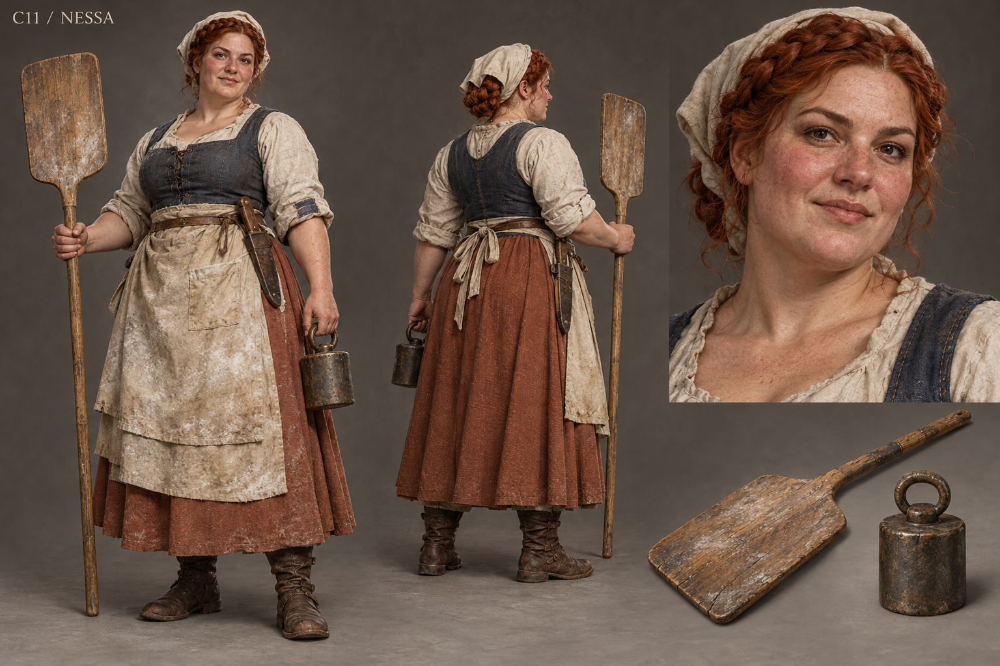

# C11 - Nessa

Established character / new visual design

**Status:** illustrated 2D design and 3D production reference. Visual design is proposed; runtime model production is not included.

## Slug

nessa

## Canonical status

Existing named Greyfen NPC; expanded principal arc proposed

## Region

Greyfen kitchen, bakery and arrival shelter

## Role

The baker whose practical authority makes promises answer to meals

## Canon facts

- Bakes for Greyfen and notices the same sack now makes nine loaves rather than twelve.
- Investigates diverted flour and a tampered scale without demanding a hungry neighbor be dragged through the square.
- Shares a kettle loan/wager dispute with Rook.
- Counts blankets rather than promises when arranging shelter for arriving travelers.
- Her baker schedule and kitchen work are established; precise age, face and costume below are new design choices.

## Desire

Make sure ordinary people can eat before leaders ask them to stand for anything.

## Contradiction

Her informal authority can become possessive when others offer help she cannot personally supervise.

## Secret

**Status**

Proposed private pressure

**Text**

She hides how often she has cut her own portion to keep the queue moving. This expands her care without inventing culpability in the old crime.

## Visual description

A proposed thirty-six-year-old woman with fair freckled skin, a broad round face, a small crooked nose, lively dark eyes and copper-red hair braided into a crown beneath a simple cream kerchief. Her strong full build communicates long hours lifting dough troughs and sacks. A faded terracotta wool skirt, rolled cream linen sleeves and indigo work bodice sit beneath a flour-marked canvas apron. One cuff has a careful blue repair. A bread knife stays safely sheathed; she carries a wooden peel and a plain weighing counterweight. Heat reddens her cheeks without glamorous makeup. Her posture is open, direct and difficult to intimidate.

## Palette

- **name:** terracotta wool; **hex:** #A56B50
- **name:** indigo bodice; **hex:** #4D5969
- **name:** flour canvas; **hex:** #D9CFB6
- **name:** baked oak; **hex:** #8A6B47

## Scale

**Height m**

1.65

**Basis**

Proposed

## Signature prop

Wooden bread peel and a corrected counterweight

## Relationships

- **with:** Rook; **basis:** Canonical kettle dispute and practical friendship
- **with:** Farmer Toma; **basis:** Canonical grain and delivery-weight connection
- **with:** Steward Merrow; **basis:** Proposed recurring negotiation of deliveries and transparent relief
- **with:** Sister Anwen; **basis:** Canonical shared shelter work for travelers

## Act arc

**Established**

Exposes practical shortfall, restores honest weighing, resolves an ordinary quarrel and prepares shelter after danger ends.

**Proposed forward**

Builds a kitchen cooperative that can outlast charitable moods; becomes a major political voice because she can demonstrate what every proclamation does to the next day's bread.

## Branch outcomes proposed

- Shared kitchen: transparent accounts and rotating work prevent one person's exhaustion from closing relief.
- Independent bakery: contracts with villages preserve access without swearing allegiance.
- Scarcity dispute: smaller portions are openly explained and challenged; aid never becomes a requirement to testify.

## Animation brief

**Locomotion**

Balanced working stride with believable upper-body weight when carrying a tray.

**Performance**

Brushes flour from a receipt, sets down food before asking a question, laughter returns naturally after disagreement.

**Clips**

- idle_knead
- walk_tray
- load_oven
- weigh_flour
- offer_bread
- dialogue_direct
- count_blankets

**Constraints**

Hands and peel contact authored; hot oven actions use proper reach and body clearance.

## Voice line proposed

Bring me the terms after breakfast. Hunger agrees with anything.

## Sources

- S4
- S5
