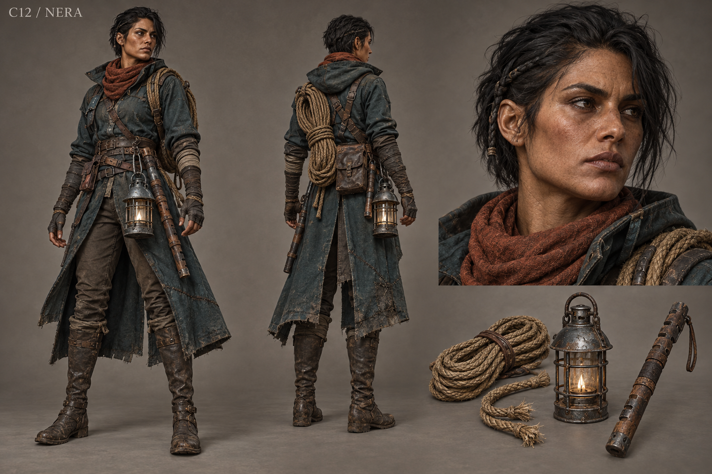

# C12 - Nera

Established character / new visual design

**Status:** illustrated 2D design and 3D production reference. Visual design is proposed; runtime model production is not included.

## Slug

nera

## Canonical status

Existing named crossing NPC; expanded principal arc proposed

## Region

Marsh Crossing and Bandit Road approach

## Role

Crossing keeper whose safety work must survive both guilt and collapsed authority

## Canon facts

- Keeps the marsh crossing and its signal posts legible in daylight as well as darkness.
- Cut a rescue cord when it threatened to pull her in, then logged a crossing failure while omitting the knife.
- The cut and dated mark establish closure before a later rescue, but do not establish who reached the far bank.
- Open or protected duplicate logs preserve the admission while new warning and rescue lines serve future travelers.
- Her rota can help replace Senn's passage demand without claiming ownership of the road.

## Desire

Make a route someone else can understand from the far bank, even when she cannot be there to guide them.

## Contradiction

She wants reliable safety records but omitted the personal decision inside her most consequential failure.

## Secret

**Status**

Canonical omitted act

**Text**

Her deliberate cut to the rescue rope. The design must not add a confirmed death or survivor identity that the evidence does not establish.

## Visual description

A proposed thirty-two-year-old woman with sun-darkened tawny skin, a broad angular face, deep-set black eyes and black hair cropped close at the back with a short practical braid above one ear. She is tall and wiry with developed shoulders and rope-worn palms. A weatherproof dark teal wool coat is split for movement over brown trousers and knee-high waxed leather boots. A short rust scarf, a coil of rescue rope, a hooded iron lantern and a notched signal baton create a strong readable silhouette. Repairs are tarred and stitched, never ornamental. Her gaze checks footing before faces; her stance remains ready to brace a load.

## Palette

- **name:** marsh teal; **hex:** #405D5C
- **name:** waxed leather; **hex:** #5D4D3B
- **name:** rust scarf; **hex:** #966048
- **name:** rope hemp; **hex:** #B4A37E

## Scale

**Height m**

1.8

**Basis**

Proposed

## Signature prop

Cut rescue cord kept beside a newly coiled line; hooded lantern and notched signal baton

## Relationships

- **with:** Captain Senn; **basis:** Canonical road outcome changes authority but not her maintenance duty
- **with:** Tavin; **basis:** Canonical crossing repair rota and supply plan
- **with:** Rook; **basis:** Proposed route partnership with protected household information
- **with:** Nessa; **basis:** Proposed supply corridor that keeps relief moving in flood season

## Act arc

**Established**

Admits the cut, restores a usable warning and rescue line, checks signals from both ends and supports passage without a pledge.

**Proposed forward**

Organizes an accountable crossing service as refugees and merchants return; the next crisis tests public safety methods that allow workers to stop rather than demand self-sacrifice.

## Branch outcomes proposed

- Shared rota: trained crews maintain rescue gear and publish closure criteria.
- Accountable keeper: Nera holds the post with open repair records and a right to relief shifts.
- Temporary closure: an honest warning and alternate supply route protect travelers; no hidden countdown punishes the player for respecting safe work.

## Animation brief

**Locomotion**

Sure-footed stride with short checks on uncertain ground; lowered center of gravity while hauling.

**Performance**

Tests a knot twice, turns lantern hood rather than waving it, looks up only once the load is secured.

**Clips**

- idle_check_line
- walk_marsh
- brace_rope
- tie_rescue_knot
- raise_signal
- hood_lantern
- dialogue_admit
- write_log

**Constraints**

Rope anchoring and tension authored; no floating coils or ungrounded bracing. Hazard communication uses shape and position as well as light.

## Voice line proposed

A safe crossing is one you can find without trusting my voice.

## Sources

- S4
- S5
