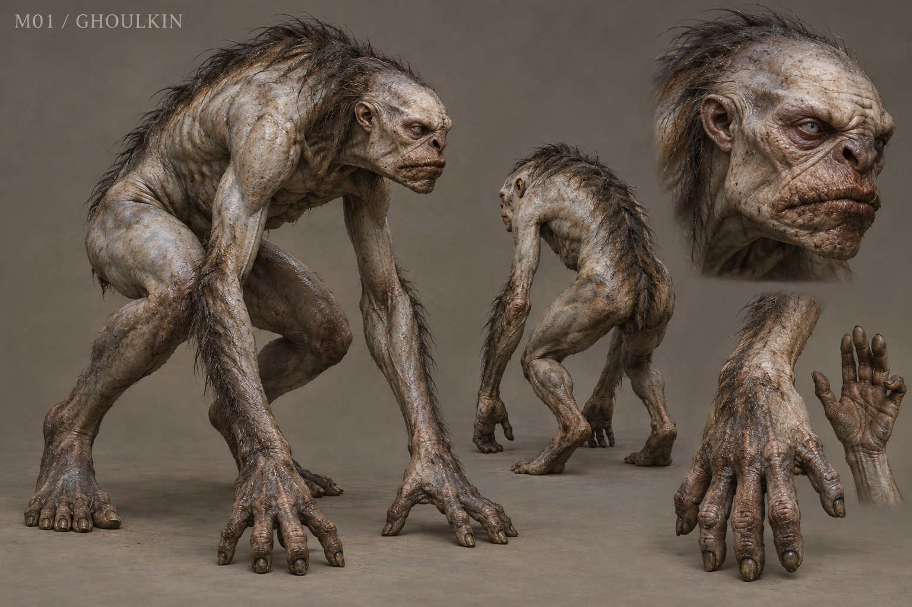

# M01 - Ghoulkin

Established creature / new visual design

**Status:** illustrated 2D design and 3D production reference. Visual design is proposed; runtime model production is not included.

## Runtime id

ghoulkin

## Canon status

existing-name

## Design status

new visual interpretation

## Silhouette

Low, wiry humanoid scavenger; long arms, compact ribs, oversized jaw and powerful haunches.

## Visual description

A wiry, long-armed humanoid scavenger, 1.63 metres upright but habitually crouched. Its oversized jaw grows naturally from a low wedge-shaped skull. The face is stretched living tissue rather than an exposed skull: small milk-grey eyes, broad flattened nose, split calloused lips. Thin charcoal hair grows unevenly along the spine and forearms. Peat-grey skin has bruised umber joints, dried mud in the folds and a subtle cold sheen. Powerful hands have four blunt digging fingers and a thumb; the feet remain plantigrade. A compact rib cage and strong haunches support its forward posture. No clothes, weapons, horns, viscera or ornamental spikes.

## Materials

- peat-stained skin
- sparse coarse hair
- blunt dirty keratin nails
- cold wet mud

## Palette

- peat grey
- bruised umber
- charcoal
- milk grey

## Scale

**Height m**

1.63

**Height basis**

canonical runtime height

**Posture**

lower habitual crouch

## Region

- Greyfen cemetery
- Wychwood road margins

## Ecology

Canonical memory-driven scavenger assembled from animal and human vessels. Its borrowed body follows erased names and abandons food for a name-bearing token; it is not an intact resurrected victim.

## Encounter role

Opening skirmisher that teaches short attack commitments and separation of a small pack.

## Telegraph

The shoulder dips and the jaw opens before a short forward rake; a token attracts a clearly visible head turn before redirection.

## Counter

Use the normal sword after the committed rake, avoid chasing the retreat, and control space between pack members. Preserve the existing normal-sword weakness.

## Nonviolent resolution

A proposed optional diversion with an already-understood token can avoid an incidental pack. Do not bypass mandatory existing combat objectives or consume unique evidence.

## Essential world function

Connects the first disturbed graves to missing names through recoverable scraps and track direction. The player learns that evidence has physical effects in the world.

## Story connection

Partial denied memory is manifested in scavenging behavior. Any recovered token is physical evidence to bring to an existing investigator, not a complete account spoken by the creature.

## Rig family

BIPED_GHOUL; retain the existing humanoid contact contract where possible

## Animation list

- idle
- walk
- run
- attack
- hit
- death
- crouch_scavenge
- token_notice
- rake_windup
- rake_recover
- pack_retreat

## Accessibility

Pair the shoulder dip with a coarse inhale and readable ground-distance cue; token attraction must be visible without relying on color.

## Model notes

Readable fingers and integrated jaw are critical. No disconnected face attachment. Treat visible humanity as fragmentary anatomy, not a named missing person's identity.
