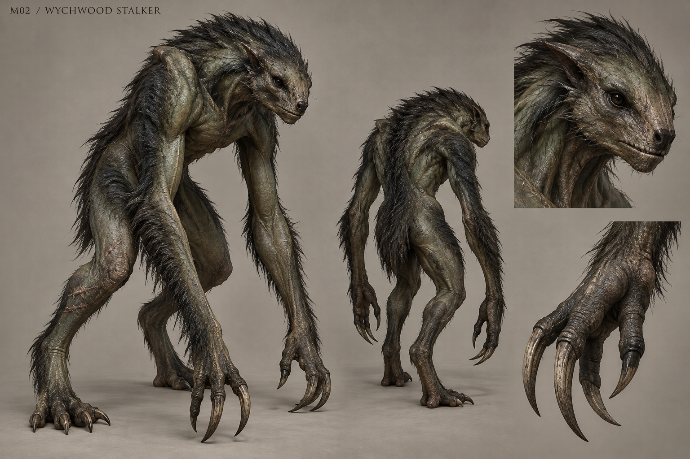

# M02 - Wychwood Stalker

Established creature / new visual design

**Status:** illustrated 2D design and 3D production reference. Visual design is proposed; runtime model production is not included.

## Runtime id

wychwood_stalker

## Canon status

existing-name

## Design status

new visual interpretation

## Silhouette

Narrow predatory biped with long forearms, folded shoulders and an almost blade-thin profile.

## Visual description

A forest predator built around a low, folded bipedal frame, 1.60 metres at its alert height. The long forearms hang almost to the ground while narrow haunches fold beneath a deep but thin chest. Its head is a small forward wedge with dark recessed eyes, a blunt muzzle and short interlocking teeth. Moss-black coarse hair lies in directional bands across slate-green leathery skin, breaking up the body without turning it into foliage. Three long load-bearing fingers and a smaller opposing digit end in climbing claws. The shoulders rise into muscular ridges rather than horns. Healed trap scars cross one shin; no wings, antlers or costume pieces.

## Materials

- slate-green hide
- coarse moss-black hair
- worn climbing claws
- healed scar tissue

## Palette

- slate green
- moss black
- cold brown
- dull ivory

## Scale

**Height m**

1.6

**Height basis**

canonical runtime height

## Region

- Wychwood
- evidence trail beyond the road attack

## Ecology

Canonical flanker drawn to the hands that moved evidence after the road attack. It remembers trap placement and circles behind a witness.

## Encounter role

A pursuit predator that makes looking behind, trap placement and safe handling of evidence meaningful.

## Telegraph

It stops circling, lowers its leading hand and fixes both shoulders toward the target before a lateral lunge.

## Counter

Use iron traps in a new position after its first avoidance response; rotate to keep the creature in view and punish a failed committed lunge.

## Nonviolent resolution

Proposed incidental encounters may be evaded along open sightlines; do not add a quest-solving negotiation or give it reliable testimony.

## Essential world function

Its route and fixation on disturbed objects help the player reconstruct where evidence was moved, rather than simply adding another forest fight.

## Story connection

Behavior corroborates physical disturbance at the road attack. It cannot identify a culprit through dialogue or reveal the complete buried history.

## Rig family

BIPED_STALKER; long-armed biped with specialized crouch and shoulder poses

## Animation list

- idle
- walk
- run
- attack
- hit
- death
- circle_left
- circle_right
- rear_lunge
- trap_inspect
- trap_avoid
- evidence_scent

## Accessibility

A sharp claw scrape and shoulder alignment mark the lunge; do not use invisible teleportation or an audio-only rear attack.

## Model notes

The silhouette must stay narrow at game distance. New proportions need a retargeting review against the retained rig rather than a promised drop-in replacement.
