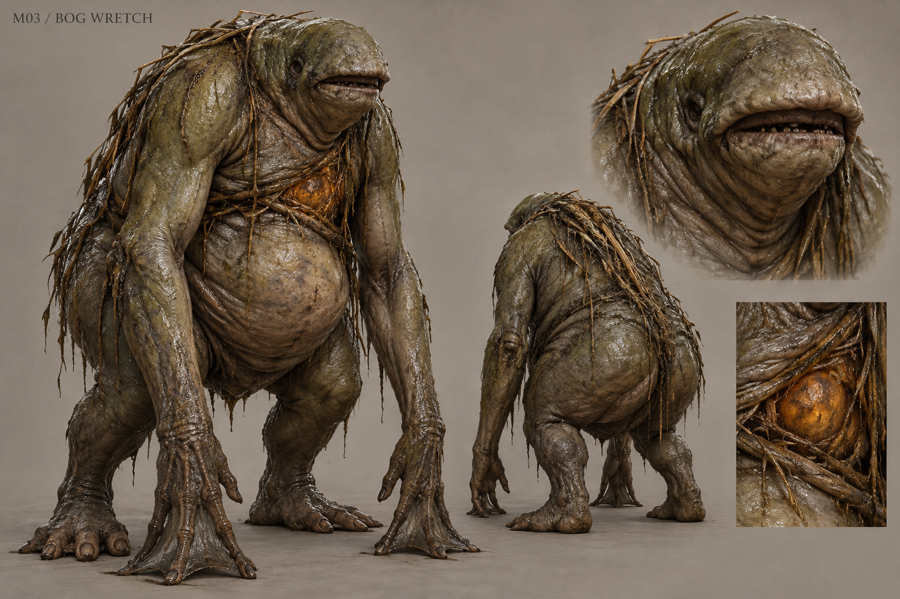

# M03 - Bog Wretch

Established creature / new visual design

**Status:** illustrated 2D design and 3D production reference. Visual design is proposed; runtime model production is not included.

## Runtime id

bog_wretch

## Canon status

existing-name

## Design status

new visual interpretation

## Silhouette

Squat, wide-bellied marsh biped with a collapsed neck, dragging arms and a single protected chest core.

## Visual description

A 1.72-metre marsh revenant with an unusually broad pelvis, heavy lowered belly and long soft arms that brace its weight in the mud. Its face is small and recessed beneath a thick folded brow; the mouth is a horizontal slit with worn dark teeth. Waterlogged olive hide gathers into leathery breathing folds along the flanks. Thin root fibres bind the upper torso around a dim, solid amber core, visible only through a natural gap in the protective folds. Long webbed fingers contrast with broad short toes. Reed fragments adhere to the wet back but do not grow into decorative antlers. The creature feels heavy, frightened and physically damp.

## Materials

- waterlogged olive hide
- peat-stained fibres
- wet reed fragments
- opaque amber core

## Palette

- marsh olive
- deep peat
- mud grey
- restrained amber

## Scale

**Height m**

1.72

**Height basis**

canonical runtime height

## Region

- Wychwood northern clearing
- memory-rich watercourse roots

## Ecology

Canonical spirit that hides beside memory-rich roots and protects the last frightened impression absorbed by the marsh.

## Encounter role

Early boss whose protected core teaches exposure and a clear punish window.

## Telegraph

The back contracts, both hands drag furrows toward the player and the torso visibly compresses before bog_reach.

## Counter

Preserve the ash-bomb weakness: ash exposes its core and causes a retreat. Attack during the exposed interval, then reset outside the reach.

## Nonviolent resolution

None in the current canonical encounter; peaceful_resolution is false. Fearful presentation adds context without inventing a peaceful quest bypass.

## Essential world function

The memory core is a required material link between the first investigation and the marsh's buried history.

## Story connection

Only a frightened memory fragment is available. Existing Hidden Memory, Exposed Root and Last Refuge phase semantics remain intact.

## Rig family

BIPED_BOG; broad body with belly and root attachments

## Animation list

- idle
- walk
- run
- attack
- hit
- death
- bog_reach
- root_hide
- ash_recoil
- core_exposed
- last_refuge

## Accessibility

The exposed core changes silhouette and posture as well as brightness; avoid a color-only vulnerability signal.

## Model notes

Keep the core below the throat so it cannot read as an accidental object across the face. Root fibres must deform with the torso.
