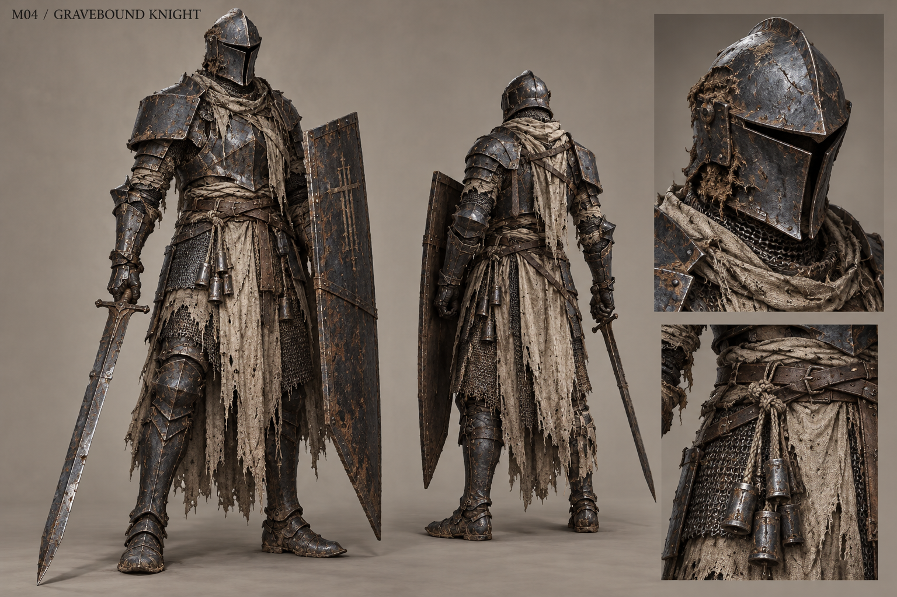

# M04 - Gravebound Knight

Established creature / new visual design

**Status:** illustrated 2D design and 3D production reference. Visual design is proposed; runtime model production is not included.

## Runtime id

gravebound_knight

## Canon status

existing-name

## Design status

new visual interpretation

## Silhouette

Upright armored sentinel; closed shoulder line, vertical blade and heavy asymmetrical shield.

## Visual description

A 1.88-metre undead sentinel enclosed in practical, corroded dark iron armor over funerary linen and exhausted mail. The helmet is a narrow enclosed sallet with an empty recessed visor, not a grinning skull. Clay and root grit pack the joints; missing armor plates reveal bound linen around an insubstantial body rather than exposed viscera. One square shoulder plate and a tall battered shield create an unmistakable vertical silhouette. Its long straight sword has a functional crossguard and a nicked edge. Broken oath cords are tied at the belt in short, weighted lengths. The feet are planted and weight-bearing, with no floating parts or arbitrary magical jewelry.

## Materials

- pitted dark iron
- worn mail
- burial linen
- clay
- oath cord

## Palette

- blue-black iron
- dirty linen
- cold clay
- old rust

## Scale

**Height m**

1.88

**Height basis**

canonical runtime height

## Region

- Vargan Approach
- sealed undercroft thresholds

## Ecology

Canonical undead sentinel convinced that obeying its order is the only way to keep the dead contained.

## Encounter role

Threshold guard that teaches patience, flank access and armor preparation.

## Telegraph

The shield locks in place and the sword rises to a clearly held guard before a deliberately committed cut.

## Counter

Preserve rot_oil as the weakness. Draw out the held attack, move around the shield and punish recovery without attacking continuously into guard.

## Nonviolent resolution

Optional threshold recognition is a proposal only; the canonical ordinary sentinel is not the same encounter as Halvern's peaceful testimony duel.

## Essential world function

Makes sealed authority physically legible and distinguishes a rote enforced order from Halvern's deliberate refusal.

## Story connection

Tests an oath but does not authenticate the whole history. Halvern remains a separately named character with a distinct silhouette, voice and bounded memory.

## Rig family

BIPED_ARMORED; ordinary sentinel, separate from Halvern character asset

## Animation list

- idle
- walk
- run
- attack
- hit
- death
- guard_raise
- oath_test
- shield_turn
- sword_commit
- guard_break

## Accessibility

Shield position and held blade angle communicate protection and attack direction without depending on spectral hue.

## Model notes

Model a clean visor interior and separate removable armor pieces. Do not reuse Halvern's named heraldry or face.
