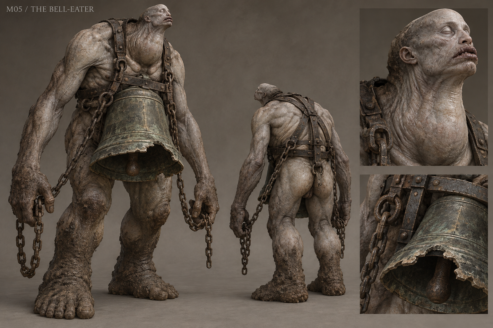

# M05 - The Bell-Eater

Established creature / new visual design

**Status:** illustrated 2D design and 3D production reference. Visual design is proposed; runtime model production is not included.

## Runtime id

bell_eater

## Canon status

existing-name

## Design status

new visual interpretation

## Silhouette

Towering bowed biped; heavy hanging bell, narrow head, long chain-bearing arms and a broad load-bearing pelvis.

## Visual description

A 3.8-metre cemetery giant whose bowed humanlike frame carries the impossible weight of an old bronze chapel bell. The cracked bell hangs against the lower rib cage on a clearly engineered iron harness; its rim is chipped where the creature has bitten it. A small elongated head rises behind the collar, with a swollen resonant throat, closed pale eyes and heavy split lips. Long muscular arms carry loose working chains that visibly connect to the harness. Cold clay-grey flesh is stretched over the upper ribs but thickens around the hips and feet. Grave mud and green-black bronze patina provide texture; there are no ornamental horns, skull crowns or random dangling bones.

## Materials

- old bronze bell
- forged iron harness
- taut clay-grey flesh
- grave mud
- chain links

## Palette

- grave grey
- old bronze
- green-black patina
- umber

## Scale

**Height m**

3.8

**Height basis**

canonical runtime height

## Region

- Greyfen cemetery

## Ecology

Canonical undead boss that consumes buried names. The bell functions as a surviving local witness-object, never a replacement for the White Hart's complete testimony.

## Encounter role

Cemetery boss with Harnessed, Unchained and Hollow Bell phases.

## Telegraph

Chain tension precedes the sweep; the bell visibly tilts before a grave-grown shockwave; both hands release outward before the Ghoulkin call.

## Counter

Preserve moon_oil weakness and the silence interruption to summons. Respect the chain sweep, read the grave shockwave path and commit during the recovery after a slam.

## Nonviolent resolution

None in the current canonical encounter; peaceful_resolution is false.

## Essential world function

Silencing the cemetery bell yields bell iron and the chapel key, making a major route and evidence transition tangible.

## Story connection

The names Greyfen buried shape the encounter. It does not narrate facts beyond its fragmented local memory.

## Rig family

GIANT_BIPED_BELL; secondary bell suspension and controlled chain joints

## Animation list

- idle
- walk
- run
- attack
- hit
- death
- chain_sweep
- bell_shockwave
- grave_slam
- ghoulkin_call
- silenced_stagger
- harness_release

## Accessibility

Bell sound is paired with visible harness tension and a stable shockwave edge; no mandatory audio-only timing.

## Model notes

The harness must make structural sense in all views. Chain collision should be deliberately simplified; gameplay timing cannot depend on uncontrolled cloth simulation.
