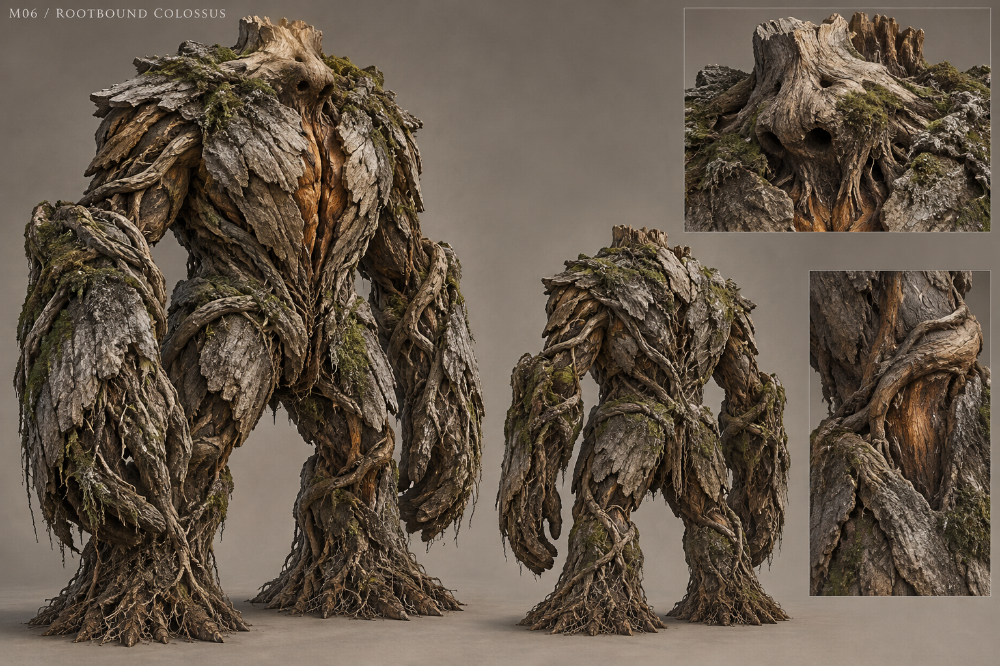

# M06 - Rootbound Colossus

Established creature / new visual design

**Status:** illustrated 2D design and 3D production reference. Visual design is proposed; runtime model production is not included.

## Runtime id

rootbound_colossus

## Canon status

existing-name

## Design status

new visual interpretation

## Silhouette

Broad, low-headed walking root mass; two pillar legs, long buttress arms and an exposed central heart seam.

## Visual description

A 4.4-metre giant formed from compacted roots and a split old trunk, with a believable load path through two short pillar legs and enormous buttress forearms. The head is a low blunt knot sunk between the shoulders, with two dark sensory hollows and no carved human face. Broad bark plates overlap across the chest; a vertical seam reveals a dense amber heartwood core only when opened. Fine root hairs gather near the feet, while larger load-bearing roots twist around hips and elbows. Ash is worked into the wood grain and moss collects in sheltered recesses. The crown is broken and broad, never a stag skull or decorative antler rack.

## Materials

- split heartwood
- layered bark
- compacted roots
- ash-filled grain
- sheltered moss

## Palette

- weathered wood grey
- deep forest green
- ash black
- heartwood amber

## Scale

**Height m**

4.4

**Height basis**

canonical runtime height

## Region

- Deep Wood memory clearing

## Ecology

Canonical spirit defending soil nourished by the ash of people Greyfen refused to name.

## Encounter role

Spatial boss whose root lanes and exposed-heart recovery teach deliberate repositioning.

## Telegraph

The planted hand spreads distinct root ridges along the ground; the centre remains visibly open before the lane attack.

## Counter

Preserve oathfire weakness and the readable central gap. Move between lanes, avoid the rupture, then attack the opened heart during the stagger.

## Nonviolent resolution

None in the current canonical encounter; peaceful_resolution is false.

## Essential world function

Clears access to the reconstruction of the burned register and provides the oathwood core, so its defeat changes the investigation route.

## Story connection

Roots preserve material consequences and partial impressions of buried ash, not a complete speaking history.

## Rig family

GIANT_ROOT_BIPED; rigid bark plates over deforming root bundles

## Animation list

- idle
- walk
- run
- attack
- hit
- death
- root_lanes
- ground_rupture
- heart_stagger
- root_plant
- bark_open
- uproot

## Accessibility

Root lane spacing, raised geometry and dust direction carry the signal; avoid green-on-green-only indicators.

## Model notes

Preserve the centre-gap combat read. Dense root texture must not turn the body into a visually uniform noisy mass.
