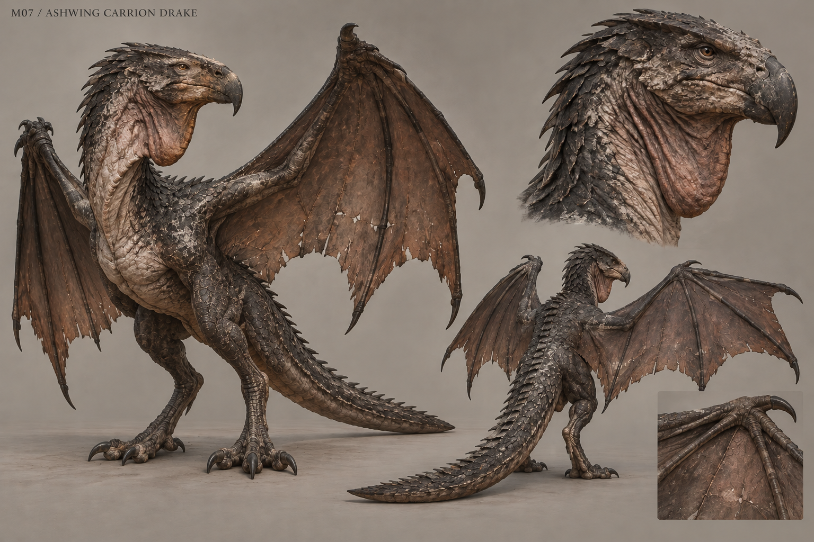

# M07 - Ashwing Carrion Drake

Established creature / new visual design

**Status:** illustrated 2D design and 3D production reference. Visual design is proposed; runtime model production is not included.

## Runtime id

ashwing

## Canon status

existing-name

## Design status

new visual interpretation

## Silhouette

Heavy carrion drake with two hind legs, two forelimb wings, a hooked blunt head and a long balancing tail.

## Visual description

A great carrion drake, 4.8 metres in its canonical posed height, with two powerful hind legs and a pair of forelimbs extended into broad leathery wings. Its chest is deep, its hooked head blunt and scavenger-like, and its long tail balances a low perch. Charcoal scales grade into wrinkled bare throat skin and thin soot-brown wing membranes with visible load-bearing fingers. Pale ash cakes sheltered scale seams; the wing edges show repaired tears rather than ornamental tatters. An expandable throat pouch precedes breath attacks. The body has no separate extra pair of arms, no crown of horns and no bright jewel-like eyes. Everything supports flight, perching and carrion feeding.

## Materials

- charcoal scales
- leathery wing membrane
- bare throat skin
- pale mill ash
- worn keratin claws

## Palette

- soot brown
- charcoal
- warm ash grey
- dull copper

## Scale

**Height m**

4.8

**Height basis**

canonical runtime posed height

**Proposed wingspan m**

8.5

**Wingspan status**

new model target requiring arena review

## Region

- Old Mill marsh edge
- mill roof and perch

## Ecology

Canonical beast nesting above the mill where refugee ash became part of the harvest.

## Encounter role

A directional-pressure boss with perch destruction and grounded vulnerability.

## Telegraph

The head aligns before ash breath, the forward wing raises before wing pressure, and both feet compress against the perch before a swoop.

## Counter

Preserve oathfire weakness. Move out of the directed breath and wing lanes, break the perch, then exploit its exposed grounded recovery.

## Nonviolent resolution

None in the current canonical encounter; peaceful_resolution is false.

## Essential world function

Breaks open the mill's physical concealment and yields drake ash and the mill seal, connecting the local food economy to the investigation.

## Story connection

Its nest and feeding remains expose evidence; the animal cannot explain what happened to the refugees.

## Rig family

DRAKE_WYVERN; two hind legs plus two wing forelimbs

## Animation list

- idle
- walk
- run
- attack
- hit
- death
- perch
- wing_blast
- ash_breath
- swoop
- perch_break_fall
- grounded_recover

## Accessibility

Directional wind debris and head alignment supplement audio. Keep breath haze from obscuring the floor and recovery window.

## Model notes

Wing membrane must have explicit tension lines and joint anatomy. Final wing dimensions must be verified against the existing arena and camera.
