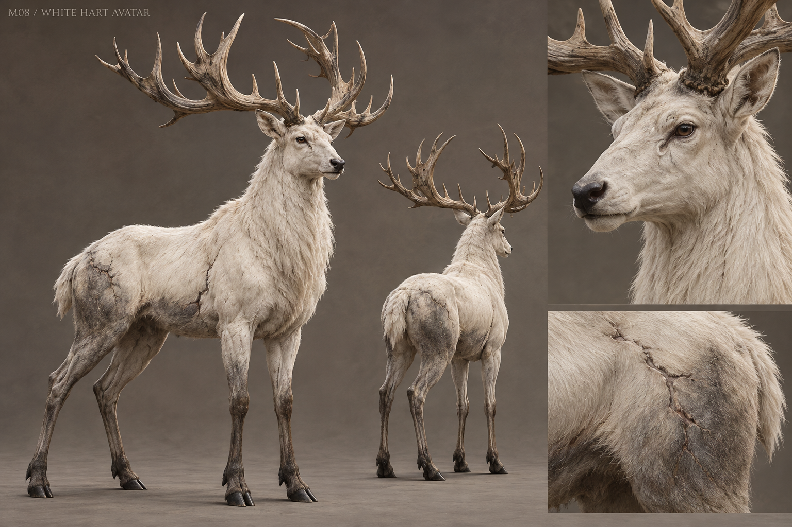

# M08 - White Hart Avatar

Established creature / new visual design

**Status:** illustrated 2D design and 3D production reference. Visual design is proposed; runtime model production is not included.

## Runtime id

white_hart_avatar

## Canon status

existing-name

## Design status

new visual interpretation

## Silhouette

Tall, austere white stag; long vertical neck, clean legs and a broad anatomically coherent antler crown.

## Visual description

A great white stag, 3.6 metres at the canonical runtime height, with long weight-bearing legs, a deep cervine chest and a solemn, wholly animal face. Short ivory fur is stained grey around the hooves and lower flanks. Its antlers rise from plausible pedicles into broad, uneven tines, worn smooth along old contact points; they are neither tree branches nor a floating crown. Dark eyes are clear and watchful, with almost no emissive glow. Thin ash-like seams interrupt the flank fur as if an old wound had healed into the coat. The neck and shoulders carry real muscle beneath the softness. No armor, jewelry, human hands or extra eyes.

## Materials

- short ivory fur
- weathered antler
- black hoof
- ash-grey scar seams

## Palette

- warm ivory
- bone beige
- ash grey
- deep brown-black

## Scale

**Height m**

3.6

**Height basis**

canonical runtime height; model bounds must specify antler inclusion

## Region

- White Hart Glade
- the road's bound memory

## Ecology

The canonical sole complete supernatural witness, bound beneath the road. It cannot lie and must not be recast as a benevolent forest god.

## Encounter role

Final witness and moral culmination; physical confrontation and a peaceful resolution are both already supported.

## Telegraph

A still head turn precedes a memory echo; the neck lowers and the front hoof marks the ground before the antler sweep.

## Counter

Preserve moon_oil weakness for combat. The narrative route must respect truthful names and reject a false oath; do not reduce the finale to harvesting a boss drop.

## Nonviolent resolution

Witness and Mercy are releases accepted by the Hart; Duty is voluntary containment; Ash is destruction by force. Recovered human proof survives all four.

## Essential world function

Provides the complete witness needed for the final oath and the road reopening; every earlier fragment gains context here.

## Story connection

The sole complete supernatural account is reserved for this encounter. Visual majesty must coexist with burden and limited agency.

## Rig family

CERVID_HART; quadruped with antler clearance and neck controls

## Animation list

- idle
- walk
- run
- attack
- hit
- death
- witness_still
- memory_echo
- antler_sweep
- mercy_lower
- oath_refusal
- road_reopening

## Accessibility

Memory effects must preserve the stag's outline and readable floor. Provide stable visual cues rather than strobing or rapidly flashing echoes.

## Model notes

Antler roots must be modeled as part of the skull structure. No generic forest deity iconography or radiant halo.
