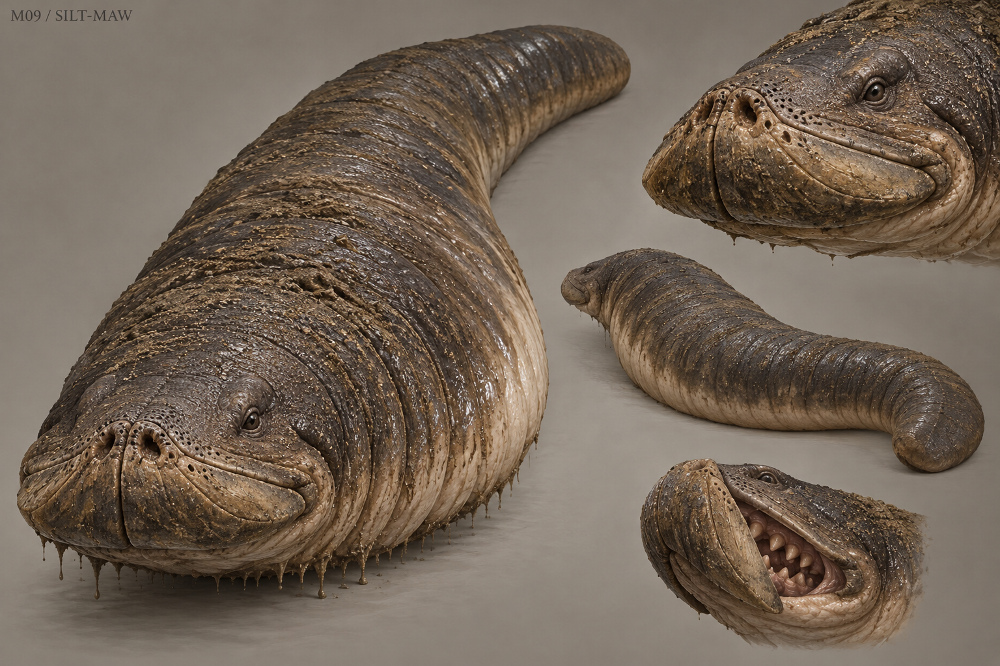

# M09 - Silt-Maw

New creature proposal

**Status:** illustrated 2D design and 3D production reference. Visual design is proposed; runtime model production is not included.

## Runtime id

None

## Canon status

new-proposal

## Design status

new species and optional quest proposal

## Silhouette

Low, limbless burrower; broad shovel head, thick tapering body and a blunt tail.

## Visual description

A muscular limbless predator about 3.2 metres long, with the low wedge-shaped head of a digging amphibian and a thick body that tapers into a blunt steering tail. Slate-brown skin is divided by shallow annular folds; the upper surface is tough and sand-scoured while the belly is pale and smooth. Tiny protected eyes sit behind ridged nostrils. Two short lateral jaw plates fold shut into the shovel-shaped snout, concealing compact teeth until feeding. Fine tactile pores ring the nose. There are no frills, horns or tentacles. Wet sediment hangs naturally from the lower folds, making its mass and underground movement easy to understand.

## Materials

- sand-scoured skin
- smooth pale belly
- mud
- small keratin jaw plates

## Palette

- slate brown
- silt grey
- pale clay
- near-black

## Scale

**Length m**

3.2

**Body height m**

0.55

**Height basis**

proposed design target

## Region

- Greyfen drainage banks
- Old Mill sluice deposits

## Ecology

A proposed predator attracted to vibration and dense organic sediment; its burrows connect drainage routes that villagers thought were sealed.

## Encounter role

Burrow ambush with terrain reading and a route-repair objective.

## Telegraph

A moving raised silt ridge slows and forms a circular mound before the snout breaks the surface.

## Counter

Step off the vibrating plank route onto firm stone, bait an eruption at an empty marked point, then strike the exposed flank during its turn.

## Nonviolent resolution

Open the old sluice and guide it toward a deeper sediment bed, restoring drainage without killing it.

## Essential world function

Its blocked burrow exposes a displaced drainage grate and a sealed packet, making water management and the movement of evidence one playable problem.

## Story connection

The packet supplies a bounded physical clue. The beast has no memory powers and knows no human secret.

## Rig family

SERPENT_BURROWER; spline body with jaw and soil-entry controls

## Animation list

- idle
- walk
- run
- attack
- hit
- death
- burrow_enter
- burrow_exit
- vibration_listen
- eruption
- flank_turn
- sluice_retreat

## Accessibility

Surface displacement and a persistent mound outline accompany vibration audio; no attack from entirely invisible ground.

## Model notes

The belly needs a continuous deformation-friendly topology. Underground movement can be represented by a controlled surface effect instead of rendering the whole buried mesh.
