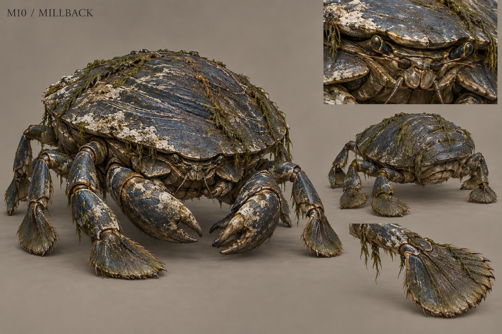

# M10 - Millback

New creature proposal

**Status:** illustrated 2D design and 3D production reference. Visual design is proposed; runtime model production is not included.

## Runtime id

None

## Canon status

new-proposal

## Design status

new species and optional quest proposal

## Silhouette

Broad low freshwater crustacean; six walking legs, two compact working claws and a ridged oval carapace.

## Visual description

A broad freshwater crustacean roughly 2.4 metres across, held low above the riverbed on six jointed walking legs. Two compact front claws fold beneath a ridged oval carapace, giving it a heavy shield-like silhouette rather than a towering crab shape. The shell is dark mineral blue with limestone abrasion, worn brown growth rings and patches of attached river weed. Short stalked eyes retract into protected sockets. The mouthparts are small and practical; no monstrous human teeth. One shell edge is visibly polished by contact with the mill wheel. The legs have consistent joints and paddle-like terminal segments for pushing through fast water.

## Materials

- mineral-stained chitin
- limestone abrasion
- river weed
- wet joint membrane

## Palette

- mineral blue
- chalk grey
- river brown
- dark olive

## Scale

**Width m**

2.4

**Height m**

0.8

**Height basis**

proposed design target

## Region

- Old Mill sluice
- Greyfen river crossings

## Ecology

A proposed scavenger that shelters in water pressure and collects dense organic scraps beneath its shell.

## Encounter role

Armor-facing puzzle around the working sluice and a moving wheel.

## Telegraph

Both claws plant into the riverbed and the back lifts before a short sideways shove.

## Counter

Avoid the frontal carapace, redirect water to expose the soft leg joints and attack only after its shove commits.

## Nonviolent resolution

Reopen a side channel and bait it with ordinary mill waste so the wheel can turn again.

## Essential world function

Restoring the mill's water flow changes food production and opens an inspection route into the waste channel; recovered refuse can be compared with the mill evidence.

## Story connection

Its shelter records the mill's recent material use. It supplies corroboration through retained debris, never testimony.

## Rig family

CRUSTACEAN_EIGHT_APPENDAGES; six walking limbs plus two claws

## Animation list

- idle
- walk
- run
- attack
- hit
- death
- side_shove
- claw_brace
- shell_lift
- channel_enter
- feeding_fold
- current_resist

## Accessibility

Current direction uses visible foam and wheel motion. The vulnerable joint opening changes shape as well as color.

## Model notes

Keep exactly six walking legs and two claw limbs. Broad shell surfaces should remain readable at low texture detail.
