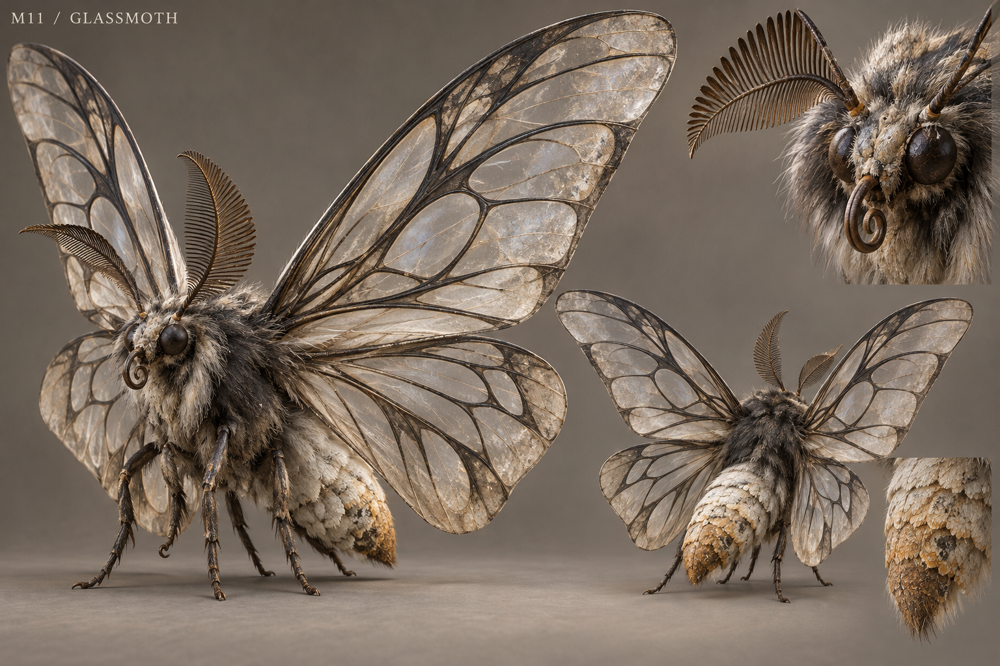

# M11 - Glassmoth

New creature proposal

**Status:** illustrated 2D design and 3D production reference. Visual design is proposed; runtime model production is not included.

## Runtime id

None

## Canon status

new-proposal

## Design status

new species and optional quest proposal

## Silhouette

Large nocturnal moth; four translucent veined wings, compact furred body and comb-like antennae.

## Visual description

A nocturnal moth with a 2.1-metre wingspan, four overlapping translucent wings and a compact furred body. The wing membranes are smoky pearl with large clear windows framed by dark, sharply organized veins. Thick charcoal thoracic hair protects the wing roots; six small legs fold neatly beneath the body. Two asymmetrical comb-like antennae are broad enough to identify it at game distance. The abdomen is pale and softly segmented, with dusty ochre scales gathering near the tip. Its face remains an insect head with compound eyes and a curled feeding tube. There are no skull patterns, human eyes or neon bioluminescent symbols.

## Materials

- translucent veined membrane
- charcoal thoracic hair
- powdery scales
- smooth chitin

## Palette

- smoky pearl
- charcoal
- pale ochre
- warm grey

## Scale

**Wingspan m**

2.1

**Body length m**

0.7

**Height basis**

proposed design target

## Region

- Wychwood
- Record Hall eaves

## Ecology

A proposed resin- and mineral-feeding nocturnal insect drawn to old sealing wax and certain damaged tree sap.

## Encounter role

Light-guided navigation and a short dust-pressure encounter that rewards restraint.

## Telegraph

It folds the clear wing windows shut, raises the abdomen and shakes the antennae before releasing dust.

## Counter

Move into a crosswind or behind solid cover; use a steady directed light to redirect flight without a permanent screen-blind effect.

## Nonviolent resolution

Move a lantern to a safe resin lure and lead the moth away from the record storage entrance.

## Essential world function

Its attraction to a specific sealing wax helps locate a concealed record shipment and introduces a practical connection between the forest and archive trade.

## Story connection

A distinctive wax residue is an observable clue requiring human interpretation. The insect does not magically identify a forged document.

## Rig family

LEPIDOPTERA; four wing controls, six small legs, antenna secondary motion

## Animation list

- idle
- walk
- run
- attack
- hit
- death
- hover
- land
- dust_windup
- dust_release
- light_follow
- wing_fold

## Accessibility

Dust lowers contrast locally without obscuring the entire display. Avoid flashing-lantern mechanics.

## Model notes

Use carefully bounded transparency and opaque vein shapes; translucency is an appearance target requiring performance review.
