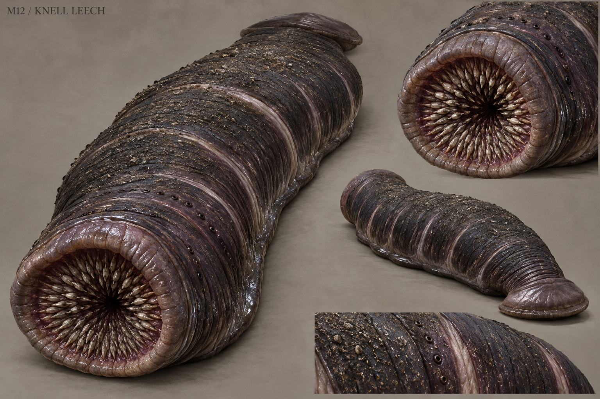

# M12 - Knell Leech

New creature proposal

**Status:** illustrated 2D design and 3D production reference. Visual design is proposed; runtime model production is not included.

## Runtime id

None

## Canon status

new-proposal

## Design status

new species and optional quest proposal

## Silhouette

Thick segmented annelid; flattened body, broad front suction disc and a smaller anchoring rear disc.

## Visual description

A thick, flattened leech roughly 1.8 metres long, with overlapping circular muscle bands and two clearly different suction discs. The broad front disc has a dense radial mouth whose small teeth appear only when the disc opens; the rear disc is a simple anchoring pad. Dull plum-black skin shines only on its wet lower edge, while the upper back is roughened by fine mineral grit. Pale pressure marks separate the rings. Tiny sensory pits run along the front third of the body; there are no eyes on stalks, limbs or decorative spikes. Its shape changes through believable muscular compression instead of stretching like rubber.

## Materials

- wet annelid skin
- mineral grit
- radial keratin mouthparts

## Palette

- plum black
- wet slate
- pale mauve-grey
- dirty ivory

## Scale

**Length m**

1.8

**Width m**

0.45

**Height basis**

proposed design target

## Region

- Greyfen flooded crypt
- undercroft drains

## Ecology

A proposed vibration-sensitive scavenger that gathers around resonant pipes and consumes organic material in old drains.

## Encounter role

Ceiling-to-floor ambush that teaches checking overhead and interrupting a latch before contact.

## Telegraph

Its rear disc anchors and the body shortens into visible accordion folds before the front disc releases toward a target.

## Counter

Break line of approach with a pillar or interrupt the exposed front disc during its windup. A short, readable latch escape replaces extended control loss.

## Nonviolent resolution

Drain the affected pipe run and redirect vibration to an empty sump, clearing a safe passage.

## Essential world function

The infestation reveals a functioning drain beneath a supposedly sealed crypt, establishing a physical route by which objects were moved.

## Story connection

Resonance explains its proximity to the cemetery bell without making it a witness or magical lie detector.

## Rig family

ANNELID_LATCHER; segmented spline with two suction controls

## Animation list

- idle
- walk
- run
- attack
- hit
- death
- rear_anchor
- compress_windup
- disc_lunge
- latch_release
- pipe_retreat

## Accessibility

Visible compression and dripping debris accompany the attack cue; provide a hold-input alternative for latch escape.

## Model notes

Mouth detail should remain non-graphic. Build the suction discs as coherent rings rather than disconnected floating teeth.
