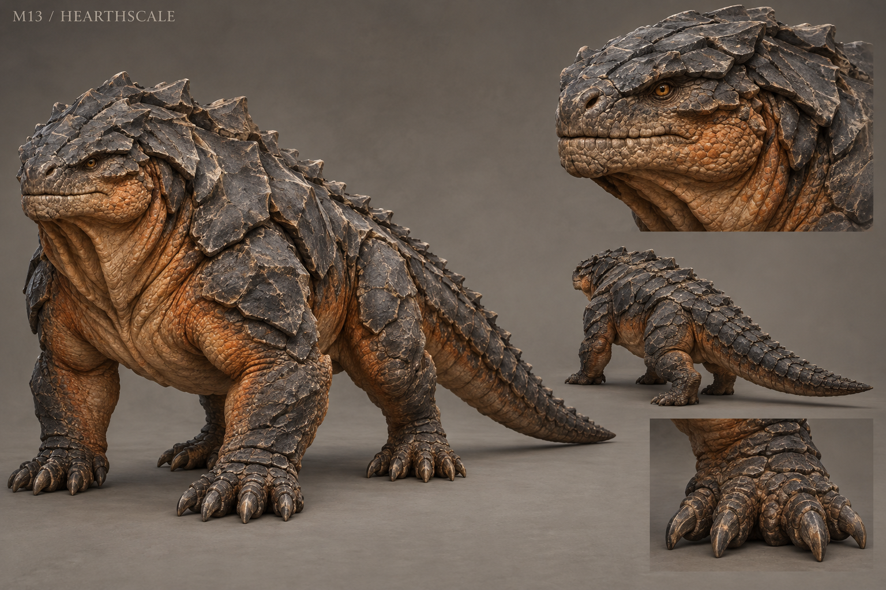

# M13 - Hearthscale

New creature proposal

**Status:** illustrated 2D design and 3D production reference. Visual design is proposed; runtime model production is not included.

## Runtime id

None

## Canon status

new-proposal

## Design status

new species and optional quest proposal

## Silhouette

Low armored quadrupedal reptile; broad head, offset mineral back plates and a heavy tail.

## Visual description

A heavy four-legged reptile about 2.7 metres from nose to tail, with a broad closed snout, short muscular neck and strongly planted clawed feet. The back carries interlocking dark mineralized plates, large near the shoulders and smaller toward a thick tapering tail. Warm clay-orange skin is visible in flexible folds beneath the plates. The throat has a pair of broad heat-dispersing creases; the eyes are small and golden-brown. Scales are chipped and dulled by kiln rubble, with pale dust in the seams. It has no volcanic cracks, glowing lava veins or flames issuing from its body. Heat is conveyed through breath, posture and environment.

## Materials

- mineralized dorsal plates
- clay-orange scale skin
- kiln dust
- worn claws

## Palette

- charcoal stone
- clay orange
- pale kiln dust
- brown gold

## Scale

**Length m**

2.7

**Shoulder height m**

0.85

**Height basis**

proposed design target

## Region

- Vargan Approach lime kilns
- Old Mill ash yards

## Ecology

A proposed reptile that nests in retained industrial heat and swallows mineral fragments to aid digestion.

## Encounter role

Armor-direction and environmental temperature encounter around a working kiln.

## Telegraph

Its throat creases open, the front feet brace and the tail lifts before a hot grit exhalation.

## Counter

Stay out of the cone, force a turn around solid masonry and strike the unarmored lower flank after the exhalation.

## Nonviolent resolution

Move its heat source to an abandoned kiln using the vent controls, allowing workers to recover the active yard.

## Essential world function

Reopening the kiln restores a local craft supply and reveals material residues needed to distinguish ordinary industrial ash from the mill's contested deposits.

## Story connection

The contrast between ash samples is investigable material evidence, not a new supernatural revelation.

## Rig family

QUADRUPED_REPTILE; heavy tail and throat expansion controls

## Animation list

- idle
- walk
- run
- attack
- hit
- death
- heat_rest
- throat_expand
- grit_exhale
- tail_brace
- flank_turn
- vent_follow

## Accessibility

Heat danger is marked by moving grit and visible bracing; avoid sustained shimmer that makes the entire screen difficult to read.

## Model notes

Dorsal plates must overlap in the direction of movement. Keep the thermal effect separate from base material readability.
