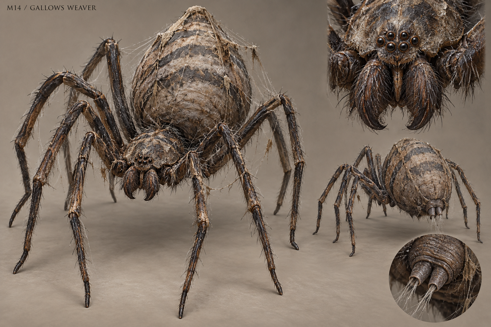

# M14 - Gallows Weaver

New creature proposal

**Status:** illustrated 2D design and 3D production reference. Visual design is proposed; runtime model production is not included.

## Runtime id

None

## Canon status

new-proposal

## Design status

new species and optional quest proposal

## Visual qa note

The intended anatomy has eight small eyes. The generated sheet's small eye cluster does not reproduce that count exactly; reconcile the cluster to eight eyes during orthographic design and modeling. This concept sheet is not an anatomically locked 3D blueprint.

## Silhouette

High-arched spider; eight long legs, compact cephalothorax and a heavy pear-shaped abdomen.

## Visual description

A large spider with a 2.6-metre leg spread, eight thin but mechanically credible legs and a pear-shaped abdomen marked with dull weathered bands. Its front body is compact and low, with eight small eyes clustered naturally above modest downward chelicerae. Fine dark bristles catch dew along the joints; the abdomen is softer, grey-brown and slightly wrinkled. Two rear spinnerets are visible beneath the body. Old cloth fibres and bark dust cling to the web around it, not to a costume on the creature. There are no human faces, skull markings, extra arms or huge exposed fangs. Its silhouette depends on arch and tension, not gore.

## Materials

- bristled chitin
- soft abdominal skin
- dew
- silk

## Palette

- weathered brown
- slate grey
- black bristle
- pearl silk

## Scale

**Leg spread m**

2.6

**Body height m**

0.9

**Height basis**

proposed design target

## Region

- Wychwood abandoned gallows track
- Vargan roadside structures

## Ecology

A proposed ambush predator using old structures as web anchors; its feeding caches preserve objects entangled with prey.

## Encounter role

Anchor-cutting traversal and an arena whose geometry can be deliberately changed.

## Telegraph

The front pair of legs lift and the abdomen contracts before a visible silk cast; a pounce begins with all rear legs compressing.

## Counter

Cut clearly marked anchor strands to limit its overhead routes, sidestep the cast, and strike during landing recovery.

## Nonviolent resolution

Create an alternate anchored web path away from the road, then retrieve a cache after it relocates.

## Essential world function

Reopens an old execution route and preserves a lost transport tag in silk, tying an optional encounter to a bounded human history.

## Story connection

The transport tag can corroborate a journey. The spider has no awareness of executions or supernatural guilt.

## Rig family

ARACHNID_EIGHT_LEGS; body suspension and paired leg cycles

## Animation list

- idle
- walk
- run
- attack
- hit
- death
- web_climb
- silk_cast
- pounce
- anchor_fail
- cache_wrap
- relocate

## Accessibility

Web anchors use consistent shapes and brightness. Include a reduced-arachnid presentation option only if the game's accessibility plan supports it; do not promise it exists.

## Model notes

Exactly eight legs. Webs need independent collision and readability controls rather than many tiny physical strands.
