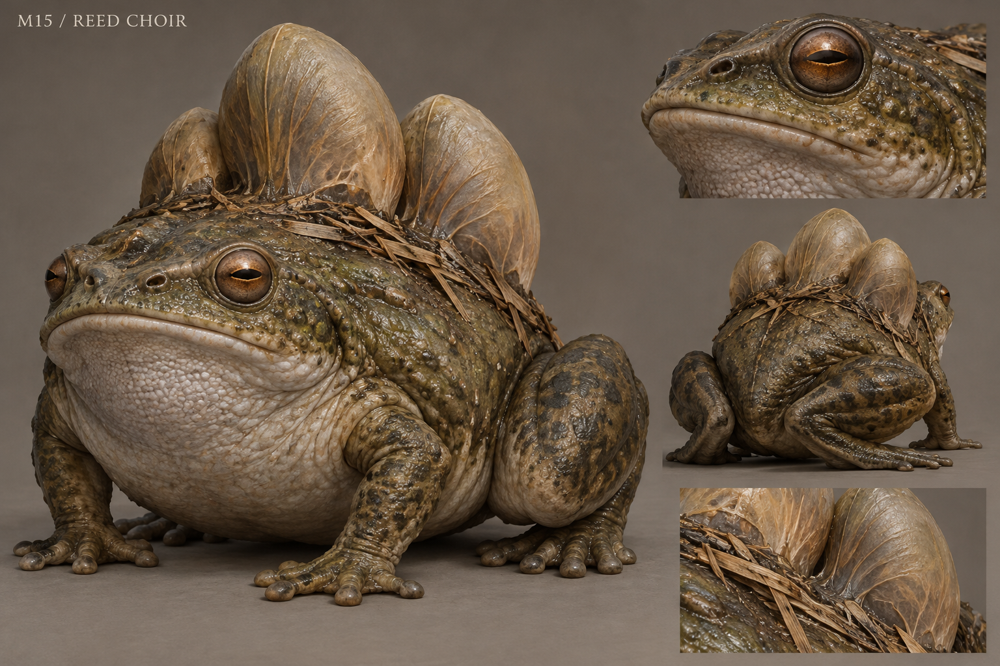

# M15 - Reed Choir

New creature proposal

**Status:** illustrated 2D design and 3D production reference. Visual design is proposed; runtime model production is not included.

## Runtime id

None

## Canon status

new-proposal

## Design status

new species and optional quest proposal

## Silhouette

Very squat marsh amphibian with three expandable dorsal resonance sacs and oversized folded rear legs.

## Visual description

A squat amphibian roughly 1.5 metres wide, supported by two short front legs and powerful folded hind legs. Three soft resonance sacs rise along its back like uneven closed bellows, visibly connected to the chest rather than floating bulbs. The head is broad and flat with lateral copper-brown eyes, a simple closed mouth and paired nostril ridges. Pebbled olive skin becomes pale grey across the throat and belly. Dry reed fragments collect in a shallow groove behind the shoulders. The sacs are translucent only at their thinnest stretched edges, revealing no organs. Its body should look heavy, damp and capable of a sudden short hop.

## Materials

- pebbled amphibian skin
- stretched sac membrane
- dry reeds
- marsh water

## Palette

- dull olive
- pale throat grey
- copper brown
- reed tan

## Scale

**Width m**

1.5

**Resting height m**

0.6

**Inflated height m**

1.2

**Height basis**

proposed design target

## Region

- Greyfen reed beds
- Old Mill marsh

## Ecology

A proposed territorial amphibian whose low calls travel through flooded channels; choruses indicate connected water rather than supernatural speech.

## Encounter role

Timed pressure pulses and a navigational clue through marsh water routes.

## Telegraph

The three sacs inflate in a fixed sequence before a broad pressure call; ripples travel outward from the feet.

## Counter

Move behind solid reeds-and-bank cover before the final sac fills, or disturb the water at a safe alternate location to redirect attention.

## Nonviolent resolution

Reopen the blocked spawning channel and guide the chorus away from the settlement's crossing.

## Essential world function

The chorus reveals which channels remain connected and lets the player trace a hidden water route; restoring spawning access changes village travel conditions.

## Story connection

A natural sound map helps locate the route used by people. The calls never repeat names or deliver human memories.

## Rig family

AMPHIBIAN_SQUAT; four limbs plus three controlled resonance sacs

## Animation list

- idle
- walk
- run
- attack
- hit
- death
- sac_sequence
- pressure_call
- short_hop
- water_listen
- spawn_channel_enter

## Accessibility

Sac inflation and water rings duplicate the call timing; the encounter must be fully readable with sound muted.

## Model notes

Use controlled blend shapes for sacs with fixed maximum volume. Keep a different silhouette and locomotion from the upright Bog Wretch.
