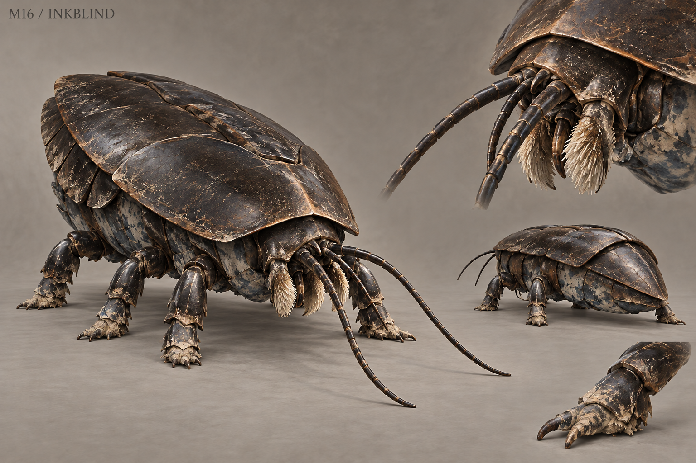

# M16 - Inkblind

New creature proposal

**Status:** illustrated 2D design and 3D production reference. Visual design is proposed; runtime model production is not included.

## Runtime id

None

## Canon status

new-proposal

## Design status

new species and optional quest proposal

## Silhouette

Blind archive beetle; blunt armored wedge, six short legs, long feelers and two folding feeding palps.

## Visual description

A flightless beetle about 1.2 metres long, with a blunt wedge-shaped carapace that fits between storage shelves. Six short jointed legs hold the body close to the floor. Its head has no visible eyes; two long segmented feelers sweep ahead of a pair of folding brush-like feeding palps. Matte black-brown shell plates are polished at the edges by repeated contact with wood. Pale paper dust gathers around the mouth and front legs, while old ink stains mark the underside in irregular grey-blue patches. The back remains a continuous solid shield, with no oversized spikes, skull markings or decorative wings.

## Materials

- matte chitin
- paper dust
- ink-stained cuticle
- fine feeding brushes

## Palette

- black brown
- paper cream
- grey blue
- warm wood brown

## Scale

**Length m**

1.2

**Height m**

0.35

**Height basis**

proposed design target

## Region

- Record Hall stores
- undercroft document vault

## Ecology

A proposed blind detritivore feeding on starch paste and damp paper rather than the written meaning of a document.

## Encounter role

Quiet navigation and document rescue under local pressure, with a visible feeding process.

## Telegraph

Both antennae align on a vibration source and the palps close before a short head-first charge.

## Counter

Stop moving on resonant shelving, use an ordinary paste lure, or sidestep a charge into an empty aisle. Do not create irreversible main-quest document loss.

## Nonviolent resolution

Set paste lures and dry the damaged storage bay, relocating the beetles while preserving the records.

## Essential world function

Makes archive neglect a material problem and reveals a recently pasted false backing through selective feeding; the document still requires human examination.

## Story connection

Its damage pattern distinguishes materials and repair age, never truth or guilt. Critical evidence remains recoverable regardless of combat outcome.

## Rig family

INSECT_SIX_LEGS; compact beetle with antenna and palp controls

## Animation list

- idle
- walk
- run
- attack
- hit
- death
- paste_feed
- antenna_align
- short_charge
- lure_follow
- shelf_hide

## Accessibility

Visible antenna motion and shelf vibration accompany hearing cues; document urgency should be forgiving and clearly communicated.

## Model notes

Keep exactly six legs and preserve the blind head design. Distinguish feeding brushes from aggressive mandibles.
