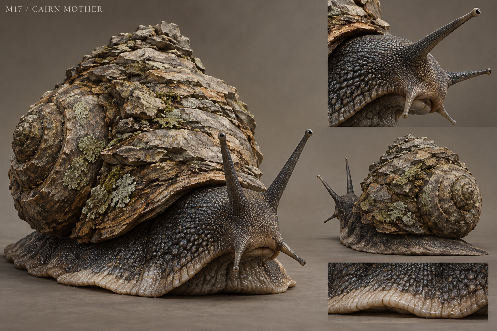

# M17 - Cairn Mother

New creature proposal

**Status:** illustrated 2D design and 3D production reference. Visual design is proposed; runtime model production is not included.

## Runtime id

None

## Canon status

new-proposal

## Design status

new species and optional quest proposal

## Silhouette

Massive slow mollusc with a low muscular foot and an irregular stone-encrusted spiral shell.

## Visual description

An enormous land mollusc, 3.5 metres long, whose muscular foot carries a heavy, low spiral shell. Mineral deposits have grown into broad uneven layers around the shell rather than a pile of balanced loose rocks. The exposed body is dark slate and finely pebbled, with a pale travelling edge pressed firmly to the ground. Two long upper feelers carry small dark eyes; two shorter lower feelers test the soil. Old lichen grows only on sheltered shell surfaces. The mouth is a modest fold beneath the head, not a ring of monstrous fangs. Its slow, continuous movement and visible load-bearing foot make the creature feel ancient and physical.

## Materials

- layered mineral shell
- slate mollusc skin
- lichen
- damp soil

## Palette

- stone grey
- slate black
- lichen sage
- pale clay

## Scale

**Length m**

3.5

**Shell height m**

1.9

**Height basis**

proposed design target

## Region

- Hart Glade margins
- abandoned Greyfen cairn paths

## Ecology

A proposed long-lived grazer that consumes lichen and mineral-rich soil; shell layers retain fragments embedded through years of travel.

## Encounter role

A moving obstruction and stewardship choice, with defensive rather than predatory aggression.

## Telegraph

The feelers retract and the shell lowers before the creature pushes a wide defensive ring of soil outward.

## Counter

Give it space, remain outside the broad push and avoid standing against its shell. Combat is possible but slow and materially wasteful.

## Nonviolent resolution

Restore its mineral feeding path and guide it away from the trail, then inspect a naturally loosened shell deposit.

## Essential world function

Opens an old cairn route and provides a dated embedded boundary marker, making land use and the age of a disputed path visible.

## Story connection

The shell is a physical record of travel, not supernatural memory. It must never rival the White Hart as a complete witness.

## Rig family

MOLLUSC_GRAZER; foot deformation, neck and four feeler controls

## Animation list

- idle
- walk
- run
- attack
- hit
- death
- graze
- feeler_test
- shell_lower
- soil_push
- withdraw
- path_follow

## Accessibility

The slow shell drop provides ample visual warning. Do not require rapid repeated inputs or hidden damage checks to resolve peacefully.

## Model notes

Run is a faster crawl state for contract compatibility, not a sprint. Keep shell encrustations integrated and avoid impossible balancing stones.
