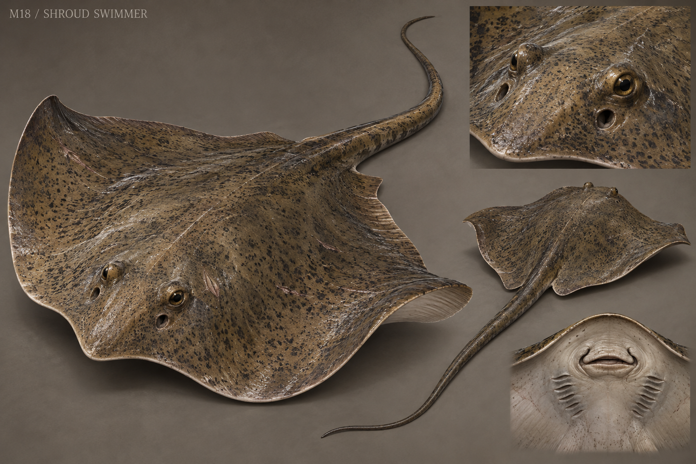

# M18 - Shroud Swimmer

New creature proposal

**Status:** illustrated 2D design and 3D production reference. Visual design is proposed; runtime model production is not included.

## Runtime id

None

## Canon status

new-proposal

## Design status

new species and optional quest proposal

## Silhouette

Broad flat freshwater ray; diamond disc, long tapering tail and a pale folded underside.

## Visual description

A broad freshwater ray, 2.8 metres across, with a low diamond-shaped disc and a long unbarbed balancing tail. The upper skin is silt-brown with fine irregular speckling; its pale underside folds like damp cloth only at the flexible wing edges. Two raised eyes and paired breathing openings sit naturally above the head. The mouth and gill slits remain on the underside, anatomically separated from the eyes. Small scars and worn edges indicate years in shallow channels. It has no human face, cloth costume, hovering ghost aura or ornamental horns. Its wide pectoral fins undulate in a slow continuous wave that can become a sudden burst.

## Materials

- fine rough ray skin
- pale flexible underside
- silt
- water sheen

## Palette

- silt brown
- pale grey
- dark speckle
- river green

## Scale

**Disc width m**

2.8

**Total length m**

4.0

**Height basis**

proposed design target

## Region

- Old Mill deep pools
- Greyfen flooded crossings

## Ecology

A proposed freshwater bottom feeder disturbed by dredging and trapped fishing gear; it buries itself under fine silt.

## Encounter role

Shallow-water displacement encounter with visible surface trails and a rescue alternative.

## Telegraph

The buried disc raises a sharp diamond ridge and both wing tips curl before a forward sediment surge.

## Counter

Move onto firm elevated footing, allow the surge to pass and approach from the side during its slow turn. Avoid punishing the player with unreadable underwater attacks.

## Nonviolent resolution

Cut the abandoned net and reopen its deep-water route, allowing it to leave the crossing.

## Essential world function

A trapped net preserves a deliberately weighted cargo bundle; freeing the animal recovers the bundle and makes the crossing safe.

## Story connection

The bundle is a bounded piece of evidence about transport and disposal. The ray is ordinary fauna, not a spirit wearing a shroud.

## Rig family

RAY_AQUATIC; paired fin deformation and tail spline

## Animation list

- idle
- walk
- run
- attack
- hit
- death
- silt_bury
- disc_raise
- sediment_surge
- net_struggle
- freed_swim

## Accessibility

Surface ridges and fin tips remain readable above water. Underwater haze must not hide the entire attack cue.

## Model notes

Walk and run map to slow and fast swim for the common state contract. The asset needs a dedicated aquatic controller, not a humanoid navigation assumption.
