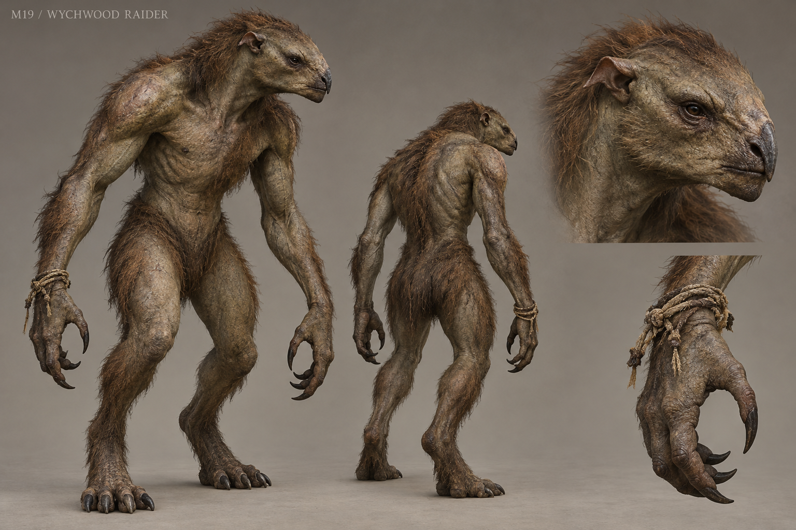

# M19 - Wychwood Raider

Established creature / new visual design

**Status:** illustrated 2D design and 3D production reference. Visual design is proposed; runtime model production is not included.

## Runtime id

wychwood_raider

## Canon status

existing-name

## Design status

new visual interpretation

## Silhouette

Forward-leaning, narrow-waisted beast biped with long hooking hands and a high asymmetric shoulder line.

## Visual description

A 1.86-metre beast with a narrow waist, high forward shoulders and long hooking hands adapted to snatching objects. Its head has a blunt keratin-edged muzzle, small lateral dark eyes and a tight closed mouth, distinct from the Ghoulkin's oversized jaw. Sparse coarse brown hair breaks across olive-grey hide in irregular patches. One shoulder is visibly higher from old healed injury; the arms remain anatomically complete and balanced. Short, backward-folding ears sit close to the skull. The feet are broad and gripping. A few name-token cords are caught around one wrist as accidental trophies, not clothing or a fantasy bandit outfit. No weapons, armor, tusk crown or decorative horns.

## Materials

- olive-grey hide
- coarse brown hair
- keratin muzzle edge
- caught cord fragments

## Palette

- olive grey
- coarse umber
- dark keratin
- faded cord beige

## Scale

**Height m**

1.86

**Height basis**

canonical runtime height

## Region

- Wychwood road evidence clearings

## Ecology

Canonical beast, not a human raider. It is drawn toward objects carrying a living person's name and feints toward the body before lunging for tokens.

## Encounter role

Feinter that teaches recognition of a false opening and protection of carried evidence.

## Telegraph

One shoulder dips in a false body attack; the true grab follows only when the wrist opens and both feet commit forward.

## Counter

Preserve normal-sword weakness. Hold through the first feint, sidestep the committed grab and punish the long recovery. Unique quest tokens remain recoverable.

## Nonviolent resolution

Proposed incidental diversion uses a duplicate ordinary name tag or established decoy; never sacrifice irreplaceable evidence or bypass a required encounter.

## Essential world function

Makes the power of named personal objects active in play and creates a recoverable trail to a displaced token cache.

## Story connection

The cache helps reconstruct movement of objects after the road attack. The creature's attraction does not prove the guilt of a token's owner.

## Rig family

BIPED_RAIDER; long fingers and asymmetric but fully functional shoulder pose

## Animation list

- idle
- walk
- run
- attack
- hit
- death
- body_feint
- token_grab
- grab_miss
- cache_drop
- decoy_notice

## Accessibility

The true grab uses an open hand and planted feet, not only a subtle timing difference or sound cue.

## Model notes

Keep the creature visibly nonhuman and unarmed. Token cords are small secondary props with controlled attachment, not face-obscuring geometry.
