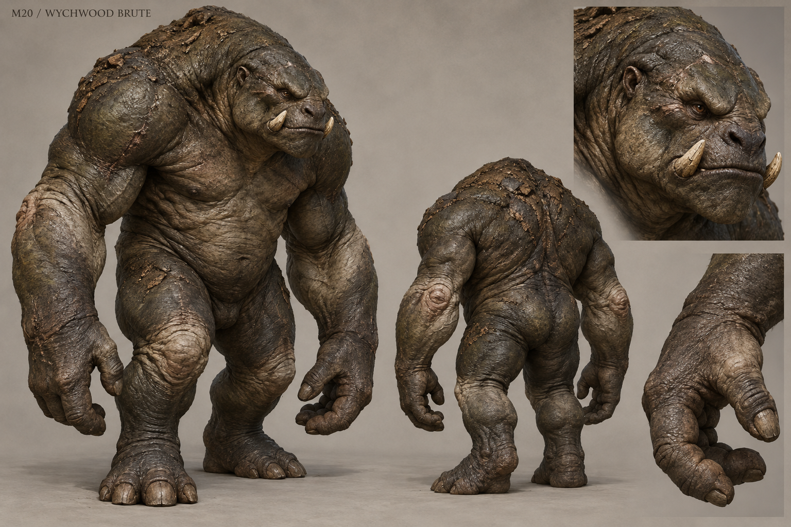

# M20 - Wychwood Brute

Established creature / new visual design

**Status:** illustrated 2D design and 3D production reference. Visual design is proposed; runtime model production is not included.

## Runtime id

wychwood_brute

## Canon status

existing-name

## Design status

new visual interpretation

## Silhouette

Very broad top-heavy beast biped; low head, block-like forearms, short thick legs and a continuous shoulder mound.

## Visual description

A 1.98-metre forest brute whose breadth matters more than height. A low heavy head sits forward beneath a continuous muscular shoulder mound; the thick neck nearly disappears into the torso. Its broad muzzle has two short worn lateral tusks, useful for pushing and breaking rather than forming a crown. Charcoal-olive hide is rough and folded over the shoulders, with paler stretched skin at the elbows and knees. Massive forearms end in blunt three-fingered load-bearing hands with an opposing thumb. Short powerful legs and broad feet make its centre of gravity credible. Embedded bark grit and healed impact scars communicate route-breaking work. No armor, club, chains or decorative spikes.

## Materials

- rough charcoal-olive hide
- worn tusk keratin
- bark grit
- healed impact scars

## Palette

- charcoal olive
- dark umber
- pale joint grey
- worn ivory

## Scale

**Height m**

1.98

**Height basis**

canonical runtime height

**Proposed shoulder width m**

1.25

## Region

- Wychwood blocked clearing routes

## Ecology

Canonical beast carrying the weight of many bodies but one unfinished command. It arrives last, breaks the route and does not pursue beyond its clearing.

## Encounter role

Space-controlling heavy that tests commitment and route awareness rather than chase speed.

## Telegraph

Both feet stamp into a wide base and the forearms pull together before a downward route-breaking slam.

## Counter

Preserve ash_bomb weakness. Bait the slam into the intended breakable obstruction, step out of the impact lane and attack during the visible recovery.

## Nonviolent resolution

Avoiding the defended clearing may be possible in optional placement; do not invent a peaceful completion of an existing mandatory combat objective.

## Essential world function

Turns blocked routes into part of the encounter and reveals what the obstruction concealed after the brute's committed attack.

## Story connection

Its repetitive unfinished command reflects fragmentary memory. It cannot name all the people whose weight it carries or explain the whole event.

## Rig family

BIPED_BRUTE; broad torso and short heavy limbs with planted contact poses

## Animation list

- idle
- walk
- run
- attack
- hit
- death
- clearing_arrival
- wide_plant
- route_slam
- obstruction_break
- ash_stagger
- boundary_stop

## Accessibility

Use a wide planted pose and visible impact lane before the slam. Camera shake should be optional and never required to read the attack.

## Model notes

Maintain a distinct low, wide silhouette from the towering Bell-Eater. Run is a short heavy surge, not a fast pursuing sprint.
