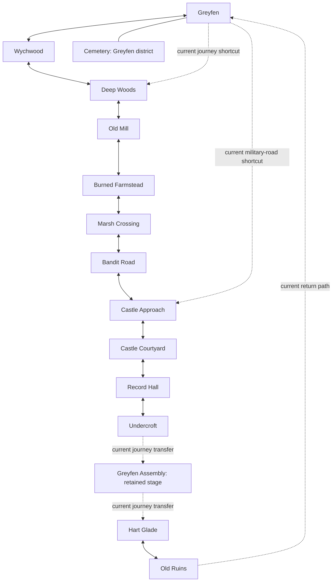

# World Connections

The runtime manifest is the graph authority. This is a route diagram, not a
claim that current local coordinates form a physically stitched continent.

## Physical Connection Requirements

- Greyfen/Wychwood is the first adjacent-context pair. It needs an owned next
  root, spatial service, enemy set, interaction registry and state signature;
  a downloaded builder script is not a prepared scene. Keep at most one neighbor.
- Publish static geometry and required population before crossing; controllers
  may not borrow whichever `game.zone_root` happens to be active during staging.
- Place the next root using matched exit/entry transforms, not the historical
  map-grid save coordinates. Preserve local-coordinate saves and camera heading.
- Greyfen's west shortcut needs a forest-spur connector; its eastern shortcut
  needs the old military road. Do not draw those existing jumps as walkable seams.
- Castle rooms need separate local contexts and authored doorway joins. A room
  return must not activate another room's encounters, interactions or rewards.
- Return from the Undercroft through Record Hall, Court and Approach; Greyfen's
  Assembly belongs to its civic phase. Preserve legacy Assembly saves explicitly.
- Use a visible, cancellable preparation fallback if required bytes or geometry
  are not ready. Never let Kael cross into missing collision or frozen scenery.

Current atlas distinguishes roads from retained journey transfers. This record
does not mark the physical adjacency/residency implementation complete.

## Owned-Context Progress (2026-10-25)

The first pair now has complete-scene preparation/reuse under ZoneBuildContext
and ZoneResidencyService: isolated construction, one prepared neighbor, suspended
controllers, source/quality invalidation and a cancellable cold-travel fallback.
The retained destination hierarchy changes World3D ownership without tree exit.
This removes the mutable-host construction prerequisite; it does not complete
matched visible thresholds, continuous camera/motion or authored connecting ground.
Those remain the next physical-join work. Build/publication and user runtime
acceptance are separate in `COHESIVE_GAME_IMPLEMENTATION.md`.
